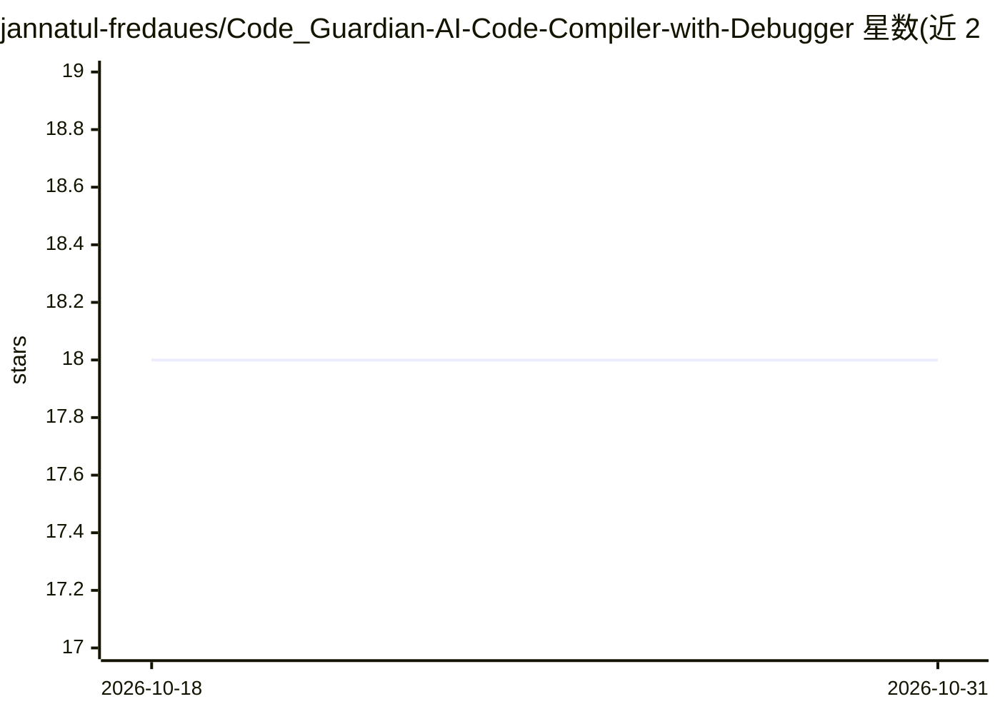

# jannatul-fredaues/Code_Guardian-AI-Code-Compiler-with-Debugger

⭐ 18 · Python · 推送 2026-06-19 · [GitHub](https://github.com/jannatul-fredaues/Code_Guardian-AI-Code-Compiler-with-Debugger) · [官网](https://www.linkedin.com/posts/jannatul-ferdaues_im-happy-to-share-a-small-achievement-of-ugcPost-7424332474886930433-RnLt?utm_source=share&utm_medium=member_desktop&rcm=ACoAAD5dS0UBtKBM1IHle1Ft3emuz2kAcwb_M1o) · 个人维护

**AI 辅助多语言在线编译器：执行代码并逐行解释错误**

支持 Python、C、C++、Java 的在线编译与执行平台，在执行引擎输出错误后由 AI 分析器生成结构化反馈：错误所在行、错误类型与人类可读的解释及修复建议。核心后端用 Python 编写，通过 subprocess 运行各语言，前端为基本 HTML。README 声明当前仅使用基础执行处理，生产环境需自行添加沙箱（如 Docker）与资源限制；Docker 沙箱、修复建议等功能列为未来改进。

## 筛选速览

| 维度 | 判定 | 备注 |
|---|---|---|
| AI 角色 | `ai-native` | 本体是模型或模型工具 |
| 许可风险 | `none` | — |
| 部署形态 | `None` |  |
| 模型依赖 | — | README 未给出锁定关系 |
| 硬件要求 | — | 无带数字的原话,不猜 |
| 安装摩擦 | `low` | 无编译、无系统依赖或容器化 |
| 成熟度 | `idea` | |

## 能力要点

- 支持 Python/C/C++/Java 四种语言的代码执行
- AI 错误分析输出行号+错误类型+解释+修复建议的结构化反馈
- 按语言拆分的 runner 模块（python_runner/c_runner/cpp_runner/java_runner）

## 适用场景

- 初学者在学习编程时获得可读懂的错误解释
- 在线编程平台为原始报错补充逐行说明
- 编程教育系统中提供调试辅助

## 场景标签

`代码审查` · 领域:编码与开发

## 证据(README 行号)

> L3: An intelligent multi-language online compiler that not only executes code but also analyzes errors using AI to provi
> L29: → AI Analyzer

## 星数曲线

2026-10-18 18 → 2026-10-31 18（+0）

---
*卡片 v1 · prompt 1.4 · 生成 2026-10-29 · 置信度 mid · 依据 README sha `1c0d67874717` · [字段定义](../../DATASET.md)*
