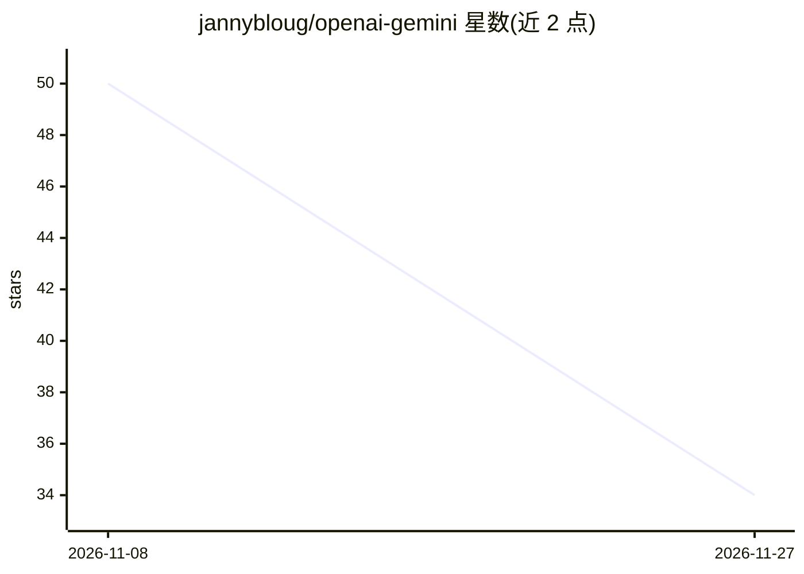

# jannybloug/openai-gemini

⭐ 34 · JavaScript · MIT · 推送 2026-11-05 · [GitHub](https://github.com/jannybloug/openai-gemini) · 个人维护

**把 Gemini API 代理为 OpenAI 兼容接口的 serverless 转发层**

在 Gemini API 之上提供 OpenAI 兼容 API 端点的个人代理服务：将 chat/completions、embeddings、models 等请求映射到 Gemini，支持 vision 与 audio 输入、web search 工具（模型名加 :search 后缀）、Gemini 特有参数（如 thinking_config 经 extra_body 传入）。面向已持有 Google API key 的个人用户，可一键或 CLI 部署到 Vercel/Netlify/Cloudflare/Deno，也可用 Node/Deno/Bun 本地运行。限制：logit_bias、logprobs、completions 等未实现。

## 筛选速览

| 维度 | 判定 | 备注 |
|---|---|---|
| AI 角色 | `ai-ecosystem` | LLM/agent 周边工具 |
| 许可风险 | `permissive` | MIT |
| 部署形态 | `library` | 以包/库形式分发 |
| 模型依赖 | — | README 未给出锁定关系 |
| 硬件要求 | — | 无带数字的原话,不猜 |
| 安装摩擦 | `low` | 无编译、无系统依赖或容器化 |
| 成熟度 | — | 结构信号不足 |

## 能力要点

- OpenAI 兼容端点：chat/completions、embeddings、models
- 支持部署到 Vercel/Netlify/Cloudflare Workers/Deno 或本地 Node/Deno/Bun 运行
- 模型名后缀 :search 启用 web search 工具
- 经 extra_body 暴露 Gemini 特有功能如 thinking_config

## 适用场景

- 让仅支持 OpenAI API 的工具接入 Gemini 免费额度
- 个人部署一个 serverless 的 OpenAI 兼容代理端点
- 在 OpenAI 格式请求中使用 Gemini 的搜索与 thinking 配置

## 场景标签

`模型网关` · 领域:Agent 开发

## 证据(README 行号)

> L4: with *generous limits*, but there are still many tools that work exclusively with the OpenAI API.
> L6: This project provides a personal OpenAI-compatible endpoint for free.

## 星数曲线

2026-11-08 50 → 2026-11-27 34（-16）

---
*卡片 v1 · prompt 1.4 · 生成 2026-11-18 · 置信度 high · 依据 README sha `9640d053ec0b` · [字段定义](../../DATASET.md)*
