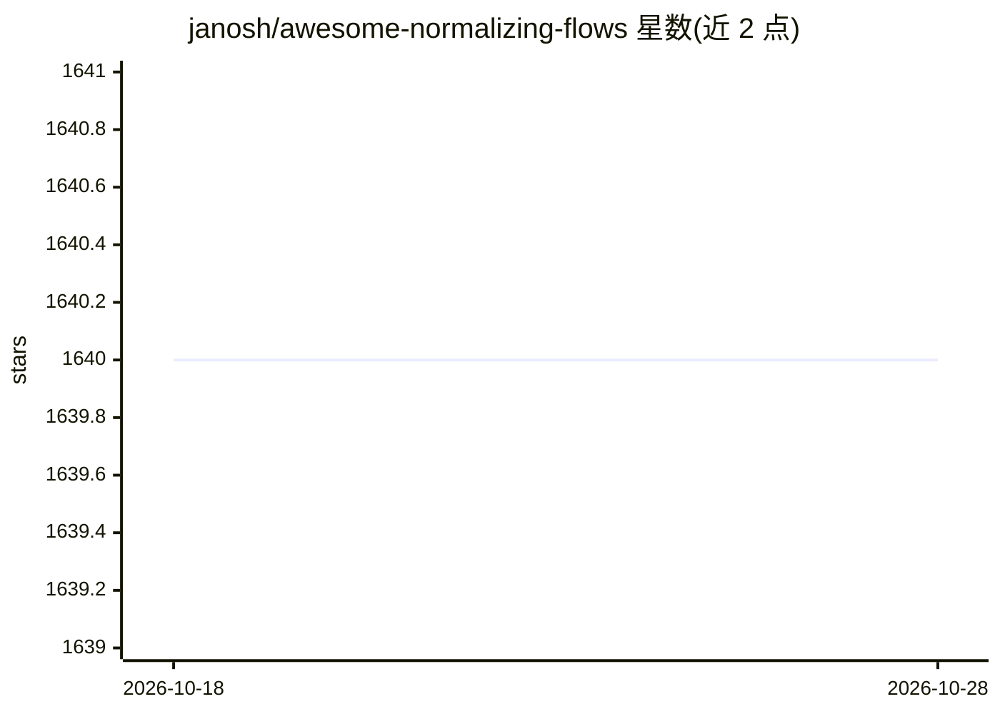

# janosh/awesome-normalizing-flows

⭐ 1,640 · Python · MIT · 推送 2026-07-31 · [GitHub](https://github.com/janosh/awesome-normalizing-flows) · 个人维护

**normalizing flows 资源策展清单：论文、软件包、仓库与博文**

janosh 维护的 normalizing flows（NF）主题 awesome 清单：收录 60 篇出版物、14 个软件包（按 PyTorch/TensorFlow/JAX/Julia 分类）、18 个代码仓库、8 个应用、8 个视频与 5 篇博文。条目含论文摘要、代码链接与日期；主题覆盖密度估计、贝叶斯采样、分子模拟、时间序列预测、对抗攻击等 NF 应用。接受 Pull Request 贡献，带链接检查与 DOI。

## 筛选速览

| 维度 | 判定 | 备注 |
|---|---|---|
| AI 角色 | `ai-knowledge` | 知识聚合/清单类 |
| 许可风险 | `permissive` | MIT |
| 部署形态 | `None` |  |
| 模型依赖 | — | README 未给出锁定关系 |
| 硬件要求 | — | 无带数字的原话,不猜 |
| 安装摩擦 | `low` | 无编译、无系统依赖或容器化 |
| 成熟度 | — | 结构信号不足 |

## 能力要点

- 60 篇论文逐条附摘要与代码链接
- 14 个 NF 软件包按 PyTorch/TensorFlow/JAX/Julia 四框架分类
- 覆盖密度估计、贝叶斯采样、分子模拟、时序预测等应用方向（8 个应用条目）

## 适用场景

- 查找 normalizing flows 的经典与最新论文及对应实现
- 按深度学习框架选择可用的 NF 软件包
- 了解 NF 在科学计算与贝叶斯推断中的应用案例

## 场景标签

`精选清单` · 领域:学习与行业

## 证据(README 行号)

> L8: A list of awesome resources for understanding and applying normalizing flows (NF): a relatively simple yet powerful 
> L21: 1. 📝 Publications (60)

## 星数曲线

2026-10-18 1,640 → 2026-10-28 1,640（+0）

---
*卡片 v1 · prompt 1.4 · 生成 2026-10-21 · 置信度 high · 依据 README sha `2474f516cb4e` · [字段定义](../../DATASET.md)*
