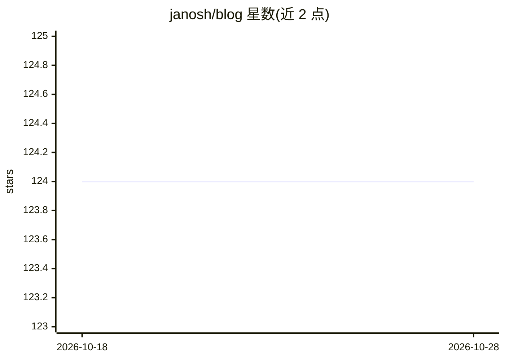

# janosh/blog

⭐ 124 · Typst · MIT · 推送 2026-10-22 · [GitHub](https://github.com/janosh/blog) · [官网](https://janosh.dev) · 个人维护

**个人博客：记录机器学习、数据可视化与 Web 开发心得**

个人博客网站，作者围绕机器学习、数据可视化、Web 开发与编程最佳实践撰写文章。README 仅含站点标题与主题说明，未提供安装、运行或功能细节，具体内容需访问博客本身。面向普通读者，非软件工具或 AI 产品。

## 筛选速览

| 维度 | 判定 | 备注 |
|---|---|---|
| AI 角色 | `ai-knowledge` | 知识聚合/清单类 |
| 许可风险 | `permissive` | MIT |
| 部署形态 | `None` |  |
| 模型依赖 | — | README 未给出锁定关系 |
| 硬件要求 | — | 无带数字的原话,不猜 |
| 安装摩擦 | `low` | 无编译、无系统依赖或容器化 |
| 成熟度 | — | 结构信号不足 |

## 能力要点

- 博文主题涵盖机器学习、数据可视化、Web 开发与编程最佳实践

## 适用场景

- 阅读机器学习与数据可视化相关学习笔记
- 查阅 Web 开发与编程实践文章

## 场景标签

 · 领域:博客/技术写作

## 证据(README 行号)

> L5: I write about things I learned in machine learning, data visualization, web development and coding best practices.

## 星数曲线

2026-10-18 124 → 2026-10-28 124（+0）

---
*卡片 v1 · prompt 1.4 · 生成 2026-10-23 · 置信度 low · 依据 README sha `cac94fc4db90` · [字段定义](../../DATASET.md)*
