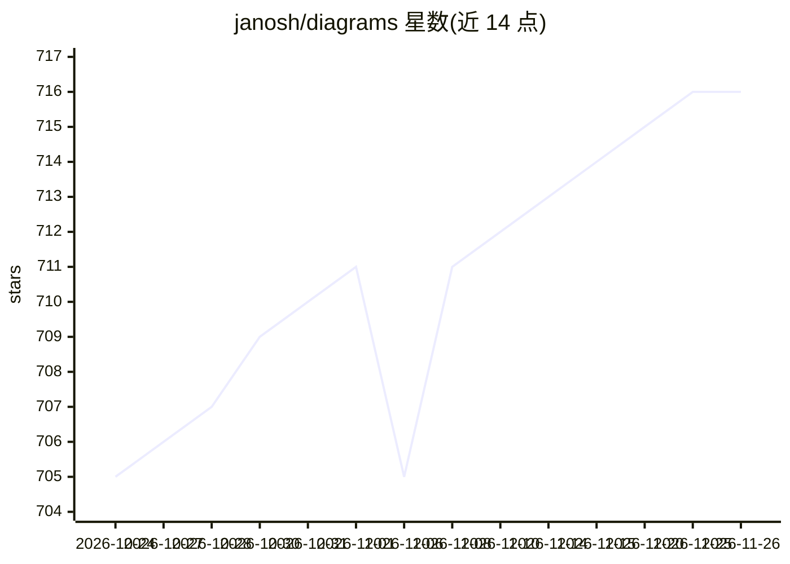

# janosh/diagrams

⭐ 716 · Typst · MIT · 推送 2026-11-21 · [GitHub](https://github.com/janosh/diagrams) · [官网](https://janosh.github.io/diagrams) · 个人维护

**科研人员可搜索下载的物理/化学/机器学习概念图集**

收录 137 幅科学示意图的图库，覆盖物理、化学与机器学习概念，以 TikZ（LaTeX）与 CeTZ（Typst）两种源码格式提供，其中 137 幅有 Typst 版本、72 幅有 LaTeX 版本。配套网站 janosh.github.io/diagrams 支持搜索、排序、在 Overleaf 中打开及下载 PDF/SVG/PNG。接受社区以 PR 方式贡献新图，需提交 .tex 或 .typ 源文件与对应的元数据 .yml 文件。仓库含 DOI 及 citation.cff 引用信息。

## 筛选速览

| 维度 | 判定 | 备注 |
|---|---|---|
| AI 角色 | `ai-knowledge` | 知识聚合/清单类 |
| 许可风险 | `permissive` | MIT |
| 部署形态 | `None` |  |
| 模型依赖 | — | README 未给出锁定关系 |
| 硬件要求 | — | 无带数字的原话,不猜 |
| 安装摩擦 | `low` | 无编译、无系统依赖或容器化 |
| 成熟度 | — | 结构信号不足 |

## 能力要点

- 137 幅物理/化学/机器学习概念图，附 TikZ 与 CeTZ 源码
- 配套网站支持搜索、排序、Overleaf 打开与 PDF/SVG/PNG 下载
- 每幅图附创作者与原始出处元数据及引用链接
- 通过 PR 提交 .tex/.typ 与 .yml 元数据即可贡献新图

## 适用场景

- 为论文、讲义或幻灯片查找可复用的科学概念示意图
- 下载 TikZ/Typst 源码并按需修改成自己的图示
- 在 Overleaf 中直接打开 LaTeX 版图示进行编辑

## 场景标签

`科研工具` · 领域:学习与行业

## 证据(README 行号)

> L3:  Illustrating concepts in physics, chemistry and machine learning.
> L11: janosh.github.io/diagrams allows searching, sorting, opening in Overleaf and downloading figures (PDF/SVG/PNG) from
> L13: Have a TikZ/CeTZ diagram you'd like to share? Submit a PR with a `.tex` or `.typ` and a corresponding metadata `.ym

## 星数曲线

2026-10-24 705 → 2026-11-26 716（+11）

---
*卡片 v1 · prompt 1.4 · 生成 2026-11-24 · 置信度 high · 依据 README sha `c0a4e5ba2aeb` · [字段定义](../../DATASET.md)*
