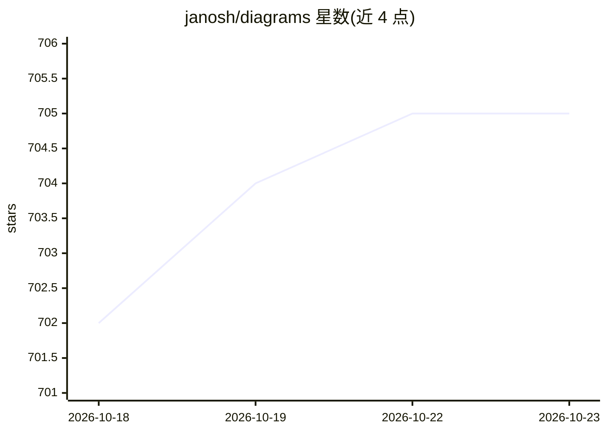

# janosh/diagrams

⭐ 705 · Typst · MIT · 推送 2026-10-22 · [GitHub](https://github.com/janosh/diagrams) · [官网](https://janosh.github.io/diagrams) · 个人维护

**物理/化学/机器学习概念科学图表集合（Typst/LaTeX 源码）**

收录物理、化学与机器学习概念示意图的开放集合：134 幅提供 Typst 源码、72 幅提供 LaTeX 源码，按条目附创作者、参考文献与原始来源链接。配套网站 janosh.github.io/diagrams 支持搜索、排序、在 Overleaf 中打开以及下载 PDF/SVG/PNG 格式图片。社区可通过提交 PR 分享 TikZ/CeTZ 图表，需附带 .tex 或 .typ 文件、assets/ 目录下的元数据 .yml 文件并登记 citation.cff。

## 筛选速览

| 维度 | 判定 | 备注 |
|---|---|---|
| AI 角色 | `ai-knowledge` | 知识聚合/清单类 |
| 许可风险 | `permissive` | MIT |
| 部署形态 | `None` |  |
| 模型依赖 | — | README 未给出锁定关系 |
| 硬件要求 | — | 无带数字的原话,不猜 |
| 安装摩擦 | `low` | 无编译、无系统依赖或容器化 |
| 成熟度 | — | 结构信号不足 |

## 能力要点

- 134 幅 Typst 源码与 72 幅 LaTeX 源码的科学示意图
- 每条目附创作者、参考文献与原始来源元数据
- 配套网站支持搜索、排序、Overleaf 打开与 PDF/SVG/PNG 下载
- 通过 PR 接受社区投稿（.tex/.typ + .yml 元数据）

## 适用场景

- 论文或教学材料中复用物理/化学/ML 概念示意图源码
- 在 Overleaf 中直接打开并修改图表
- 学习 TikZ/CeTZ 科学图表的绘制写法

## 场景标签

`精选清单` · 领域:学习与行业

## 证据(README 行号)

> L1: 134 Scientific Diagrams
> L3:  Illustrating concepts in physics, chemistry and machine learning.
> L11: janosh.github.io/diagrams allows searching, sorting, opening in Overleaf and downloading figures (PDF/SVG/PNG) from

## 星数曲线

2026-10-18 702 → 2026-10-23 705（+3）

---
*卡片 v1 · prompt 1.4 · 生成 2026-10-21 · 置信度 high · 依据 README sha `86de4fe8e0ec` · [字段定义](../../DATASET.md)*
