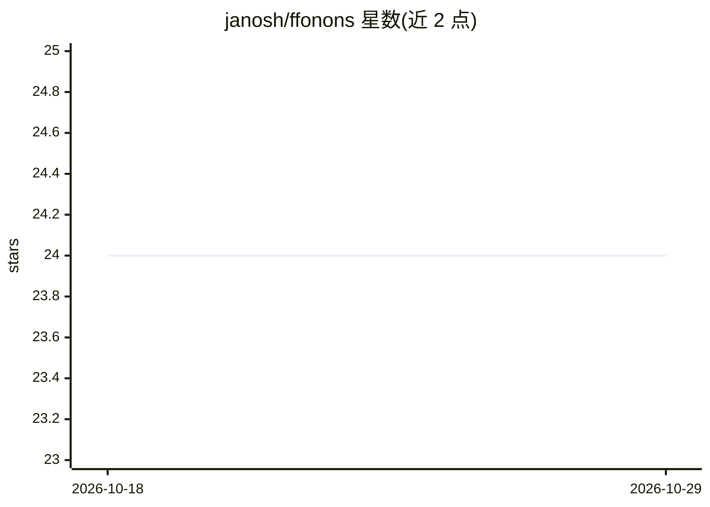

# janosh/ffonons

⭐ 24 · Python · 推送 2026-03-22 · [GitHub](https://github.com/janosh/ffonons) · [官网](https://janosh.github.io/ffonons/) · 个人维护

**用机器学习力场基础模型预测材料谐振声子的分析工具**

FFonons 是一个分析机器学习力场基础模型（如 CHGNet、MACE-MP）预测谐振声子的工具，面向计算材料学研究者。其示例包含对 mp-2691 材料用 CHGNet v0.3.3 与 MACE-MP-0 计算声子能带与态密度，并与 Togo 声子数据库的 PBE 参考数据对比。README 自述仍为进行中的工作，项目页面位于 janosh.github.io/ffonons。

## 筛选速览

| 维度 | 判定 | 备注 |
|---|---|---|
| AI 角色 | `ai-native` | 本体是模型或模型工具 |
| 许可风险 | `none` | — |
| 部署形态 | `None` |  |
| 模型依赖 | — | README 未给出锁定关系 |
| 硬件要求 | — | 无带数字的原话,不猜 |
| 安装摩擦 | `low` | 无编译、无系统依赖或容器化 |
| 成熟度 | `idea` | |

## 能力要点

- 基于基础模型力场（FF）预测谐振声子
- 示例对比 CHGNet v0.3.3 与 MACE-MP-0 的声子能带与态密度
- 与 Togo 声子数据库 PBE 参考数据对比

## 适用场景

- 用机器学习力场快速计算材料的声子能带与态密度
- 评估不同基础模型力场在声子预测上的差异
- 材料动力学稳定性筛选

## 场景标签

`科研工具` · 领域:学习与行业

## 证据(README 行号)

> L6: Analysis of foundation model force fields (FF) to predict harmonic phonons.
> L12: Example: Phonon bands and DOS for mp-2691 comparing CHGNet v0.3.3 and MACE-MP-0 with PBE reference data from Togo's

## 星数曲线

2026-10-18 24 → 2026-10-29 24（+0）

---
*卡片 v1 · prompt 1.4 · 生成 2026-10-27 · 置信度 mid · 依据 README sha `6551fe1c5cbc` · [字段定义](../../DATASET.md)*
