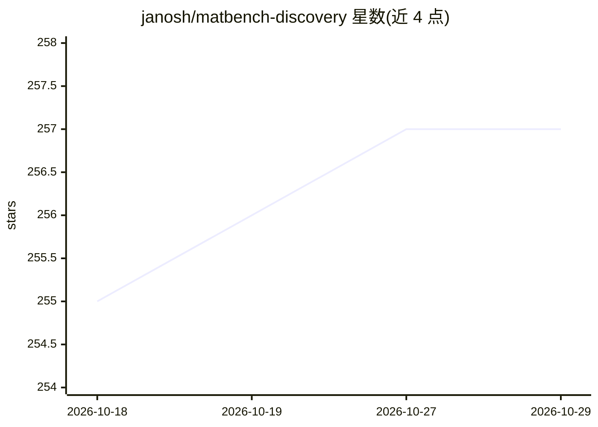

# janosh/matbench-discovery

⭐ 257 · Python · MIT · 推送 2026-10-19 · [GitHub](https://github.com/janosh/matbench-discovery) · [官网](https://matbench-discovery.materialsproject.org) · 个人维护

**评测 ML 原子间势模型在材料发现任务中表现的基准排行榜**

面向材料模拟领域研究者的评测框架与交互式排行榜：对机器学习原子间势模型在晶体稳定性预测、几何优化、声子与热导率、分子动力学、双原子势能曲线等任务上排名，覆盖 GNN 原子间势、GNN 一次预测器、贝叶斯优化器与随机森林等方法。以准确性、鲁棒性与计算成本权衡为指标辅助模型选型；稳定性评估使用的凸包由 DFT 参考能量构建而非模型预测。需 Python 3.14+，经 PyPI 分发，配套论文发表于 Nat Mach Intell。

## 筛选速览

| 维度 | 判定 | 备注 |
|---|---|---|
| AI 角色 | `ai-ecosystem` | LLM/agent 周边工具 |
| 许可风险 | `permissive` | MIT |
| 部署形态 | `library` | 以包/库形式分发 |
| 模型依赖 | — | README 未给出锁定关系 |
| 硬件要求 | — | 无带数字的原话,不猜 |
| 安装摩擦 | `low` | 无编译、无系统依赖或容器化 |
| 成熟度 | — | 结构信号不足 |

## 能力要点

- 跨晶体稳定性、声子、热导率、分子动力学等多任务的排行榜
- 覆盖 GNN 原子间势、贝叶斯优化器、随机森林等方法
- 报告准确性、鲁棒性与计算成本的权衡指标

## 适用场景

- 为静态与有限温度材料模拟挑选 ML 原子间势模型
- 提交新模型到排行榜参与评测
- 比较不同方法在各材料预测任务上的表现

## 场景标签

`模型评测` · 领域:评测与运维

## 证据(README 行号)

> L14: Matbench Discovery is an interactive leaderboard that ranks ML interatomic potentials across crystal stability pred
> L20: The benchmark exposes accuracy, robustness, and computational-cost trade-offs across these tasks to help users choo

## 星数曲线

2026-10-18 255 → 2026-10-29 257（+2）

---
*卡片 v1 · prompt 1.4 · 生成 2026-10-22 · 置信度 high · 依据 README sha `eb493d7e49be` · [字段定义](../../DATASET.md)*
