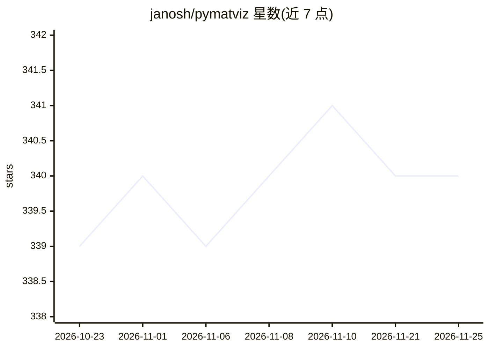

# janosh/pymatviz

⭐ 340 · Python · MIT · 推送 2026-11-23 · [GitHub](https://github.com/janosh/pymatviz) · [官网](https://janosh.github.io/pymatviz) · 个人维护

**材料信息学可视化工具库，面向材料科研绘图**

面向材料信息学的 Python 可视化工具包，提供元素周期表热图、声子带结构与 DOS、成分/结构聚类、布里渊区、XRD 谱、径向分布函数与配位数等图表。基于 matplotlib/plotly 生态，交互式 3D 结构与轨迹组件通过 anywidget 在 Jupyter、Marimo 和 VSCode notebook 中运行；widget 支持 to_html/to_img 导出，可在无前端的脚本、CI 与 agent 工作流中使用。接受 kemio、pymatgen、ASE、phonopy 对象作为输入但自身不依赖它们。静态导出需另装 Playwright 及 Chromium。

## 筛选速览

| 维度 | 判定 | 备注 |
|---|---|---|
| AI 角色 | `ai-enhanced` | 去掉 AI 部分产品仍成立 |
| 许可风险 | `permissive` | MIT |
| 部署形态 | `library` | 以包/库形式分发 |
| 模型依赖 | — | README 未给出锁定关系 |
| 硬件要求 | — | 无带数字的原话,不猜 |
| 安装摩擦 | `low` | 无编译、无系统依赖或容器化 |
| 成熟度 | — | 结构信号不足 |

## 能力要点

- 元素周期表热图/直方图/散点等多种可视化形式
- 成分聚类支持 One-hot/Magpie 嵌入与 PCA/t-SNE/UMAP/Isomap 降维
- 交互式 widget 可在脚本、CI 与 agent 工作流中导出 HTML/PNG/SVG/PDF
- 接受 pymatgen、ASE、phonopy 对象输入，运行时零依赖

## 适用场景

- 为材料数据集做探索性数据分析与论文图表绘制
- 可视化机器学习模型的预测结果与不确定性
- 在 CI 或脚本中批量导出结构/XRD 等静态图像

## 场景标签

`数据分析` `科研工具` · 领域:效率与自动化

## 证据(README 行号)

> L5: A toolkit for visualizations in materials informatics.
> L98: See `pymatviz/widgets`. Interactive 3D structure, molecular dynamics trajectory and composition visualization widge
> L107: All widgets support export and inspection APIs that work in plain Python scripts, CI, and agent workflows — no not

## 星数曲线

2026-10-23 339 → 2026-11-25 340（+1）

---
*卡片 v1 · prompt 1.4 · 生成 2026-11-25 · 置信度 mid · 依据 README sha `3411f6162224` · [字段定义](../../DATASET.md)*
