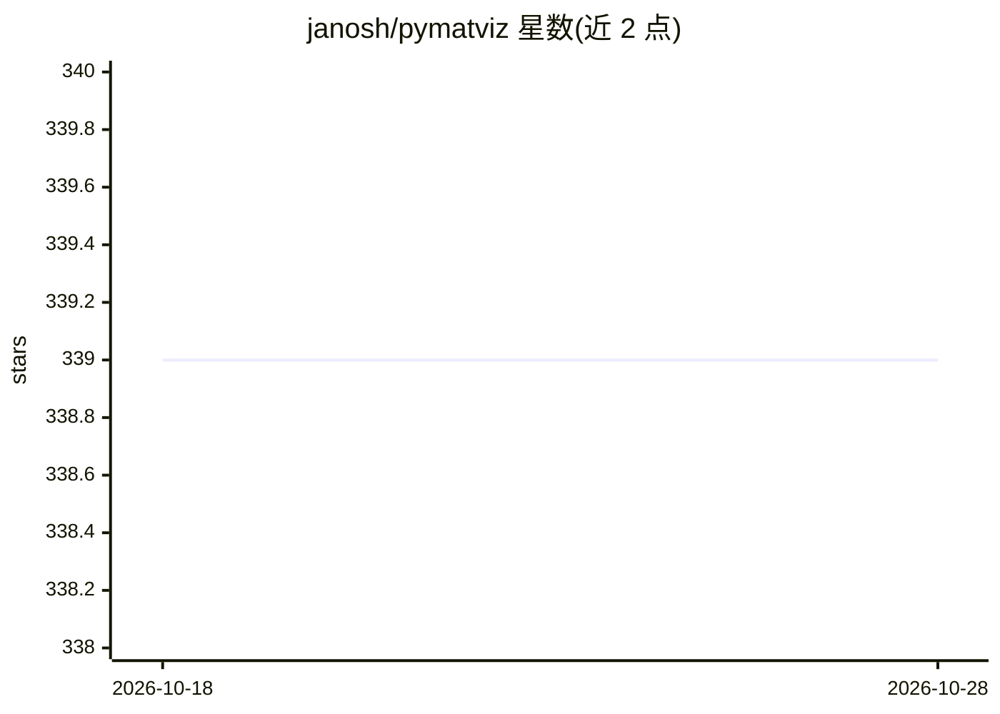

# janosh/pymatviz

⭐ 339 · Python · MIT · 推送 2026-10-19 · [GitHub](https://github.com/janosh/pymatviz) · [官网](https://janosh.github.io/pymatviz) · 个人维护

**材料信息学可视化 Python 工具库，覆盖元素周期表到晶体结构**

面向材料科学研究者的 Python 可视化库：提供周期表热图/直方图/散点、声子能带与态密度、成分与结构聚类、3D 晶体结构、布里渊区、XRD 图样、径向分布函数、配位统计、Sunburst 与 Treemap 等绘图函数。基于 Plotly 生成交互式图形，内置 Jupyter/Marimo/VSCode 交互组件，支持导出 HTML/图片。成分聚类功能可选用 Magpie/Matscholar/MEGNET 嵌入与 PCA/t-SNE/UMAP 等降维方法。需 Python 3.12+，通过 pip 安装。

## 筛选速览

| 维度 | 判定 | 备注 |
|---|---|---|
| AI 角色 | `ai-enhanced` | 去掉 AI 部分产品仍成立 |
| 许可风险 | `permissive` | MIT |
| 部署形态 | `library` | 以包/库形式分发 |
| 模型依赖 | — | README 未给出锁定关系 |
| 硬件要求 | — | 无带数字的原话,不猜 |
| 安装摩擦 | `low` | 无编译、无系统依赖或容器化 |
| 成熟度 | — | 结构信号不足 |

## 能力要点

- 周期表多模式可视化（热图/分块热图/直方图/散点/折线）
- 基于 Plotly 的交互式图形与 anywidget/MatterViz 交互组件
- 成分聚类支持 One-hot/Magpie/Matscholar/MEGNET 嵌入与 PCA/t-SNE/UMAP 等降维
- widget 可导出 HTML/PNG 等格式，支持无 notebook 前端的 CI 与 agent 工作流

## 适用场景

- 可视化材料数据集的元素分布与结构特征
- 绘制并检查声子能带、XRD 图样与径向分布函数
- 在 notebook 中交互浏览晶体结构与分子动力学轨迹

## 场景标签

`科研工具` · 领域:学习与行业

## 证据(README 行号)

> L5: A toolkit for visualizations in materials informatics.
> L45: See `pymatviz/ptable/figures.py`. The module supports heatmaps, heatmap splits (multiple values per element), histo

## 星数曲线

2026-10-18 339 → 2026-10-28 339（+0）

---
*卡片 v1 · prompt 1.4 · 生成 2026-10-21 · 置信度 high · 依据 README sha `09146c68e50c` · [字段定义](../../DATASET.md)*
