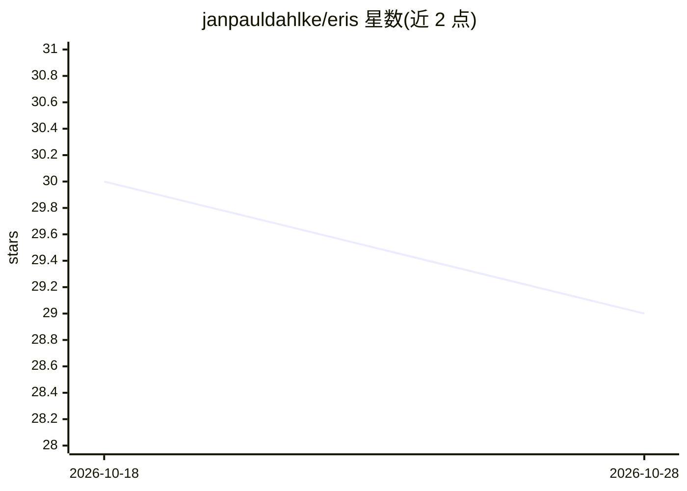

# janpauldahlke/eris

⭐ 29 · Rust · Apache-2.0 · 推送 2026-09-22 · [GitHub](https://github.com/janpauldahlke/eris) · [官网](https://eris-system.dev/) · 个人维护

**本地优先的 Rust Markdown 笔记库个人 agent，基于 llama.cpp**

单一 Rust 二进制的本地个人 agent：将 Obsidian 兼容的 Markdown 笔记库作为记忆载体，通过 llama.cpp 运行本地 GGUF 模型读写笔记、跨会话分层记忆（临时/落库/Qdrant 语义召回）、管理提醒闹钟、执行白名单内的 web 检索。工具调用通过 GBNF 文法在 token 层面结构性约束 JSON 输出，不依赖 function-calling API。提供 ratatui 终端 UI、localhost web UI 与可选 Discord sidecar。Ollama 可作为替代后端（无文法约束）。需从源码构建，自称 Alpha 阶段，主要在 macOS（Apple Silicon）与 Linux 上验证。

## 筛选速览

| 维度 | 判定 | 备注 |
|---|---|---|
| AI 角色 | `ai-native` | 本体是模型或模型工具 |
| 许可风险 | `permissive` | Apache-2.0 |
| 部署形态 | `self-host` | docker 或自建部署 |
| 模型依赖 | local-ok | 支持本地模型 |
| 硬件要求 | — | 无带数字的原话,不猜 |
| 安装摩擦 | `low` | 无编译、无系统依赖或容器化 |
| 成熟度 | `idea` | |

## 能力要点

- GBNF 文法在 token 层面强制约束工具调用的 JSON 输出
- 分层记忆：临时会话 + 笔记库落库 + Qdrant 语义召回
- 无遥测外发，所有出站集成（web/邮件/日历/Discord）均为 opt-in
- 同一编排器支持终端 TUI、localhost web UI 与 Discord sidecar 三种界面

## 适用场景

- 在本地用自然语言让 agent 读写和检索自己的 Markdown 笔记库
- 离线环境下运行个人助理处理提醒、闹钟与跟进任务
- 在自有笔记数据之上做跨会话记忆的个人 agent

## 场景标签

`AI 助手` `知识库管理` · 领域:对话与助手

## 证据(README 行号)

> L7: **A local-first agent in a single Rust binary: your Markdown vault as memory, grammar-enforced tool calls on llama.c
> L9: **Eris** runs a local LLM as a personal agent over a plain-Markdown vault (Obsidian-compatible). It reads and writes

## 星数曲线

2026-10-18 30 → 2026-10-28 29（-1）

---
*卡片 v1 · prompt 1.4 · 生成 2026-10-26 · 置信度 mid · 依据 README sha `b9d02803ef8e` · [字段定义](../../DATASET.md)*
