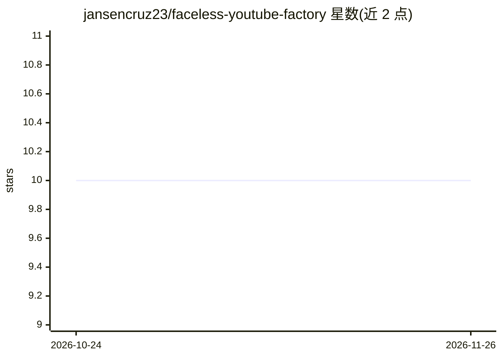

# jansencruz23/faceless-youtube-factory

⭐ 10 · Python · MIT · 推送 2026-02-12 · [GitHub](https://github.com/jansencruz23/faceless-youtube-factory) · 个人维护

**从提示词生成无脸短视频并自动发布到 YouTube 的工具**

端到端的 AI 视频生成流水线：Groq 上的 Llama 3.3 生成多说话人脚本，按角色从 100+ Microsoft Edge TTS 语音中选角并可调音调语速，结合背景视频/音乐与 Whisper 词级字幕合成 9:16 或 16:9 视频，再自动上传 YouTube 并生成元数据。前端 Next.js，后端 FastAPI + LangGraph，PostgreSQL 存储，支持 n8n 定时自动化与 API key 鉴权的服务端触发，通过 Docker Compose 一键启动。

## 筛选速览

| 维度 | 判定 | 备注 |
|---|---|---|
| AI 角色 | `ai-native` | 本体是模型或模型工具 |
| 许可风险 | `permissive` | MIT |
| 部署形态 | `self-host` | docker 或自建部署 |
| 模型依赖 | locked-api |  |
| 硬件要求 | — | 无带数字的原话,不猜 |
| 安装摩擦 | `low` | 无编译、无系统依赖或容器化 |
| 成熟度 | — | 结构信号不足 |

## 能力要点

- LLM 脚本→语音选角→音频→视频合成→YouTube 上传的完整流水线
- Whisper 词级字幕与弹出动画
- n8n 定时自动化，含 Google Sheets 话题跟踪与 LLM 去重
- WebSocket 实时推送生成进度

## 适用场景

- 批量生产无脸短视频内容
- 定时自动生成并上传视频到 YouTube
- 通过 API 将视频生成接入其他系统

## 场景标签

`视频生成` `语音合成` `工作流自动化` · 领域:效率与自动化

## 证据(README 行号)

> L3: AI-powered video generation and multi-platform upload automation. Create engaging short-form videos from text prompt
> L41: |**Backend**|FastAPI, LangGraph, Groq LLM, Edge-TTS, MoviePy, FFmpeg, Whisper|

## 星数曲线

2026-10-24 10 → 2026-11-26 10（+0）

---
*卡片 v1 · prompt 1.4 · 生成 2026-11-19 · 置信度 high · 依据 README sha `d0f6ecd07113` · [字段定义](../../DATASET.md)*
