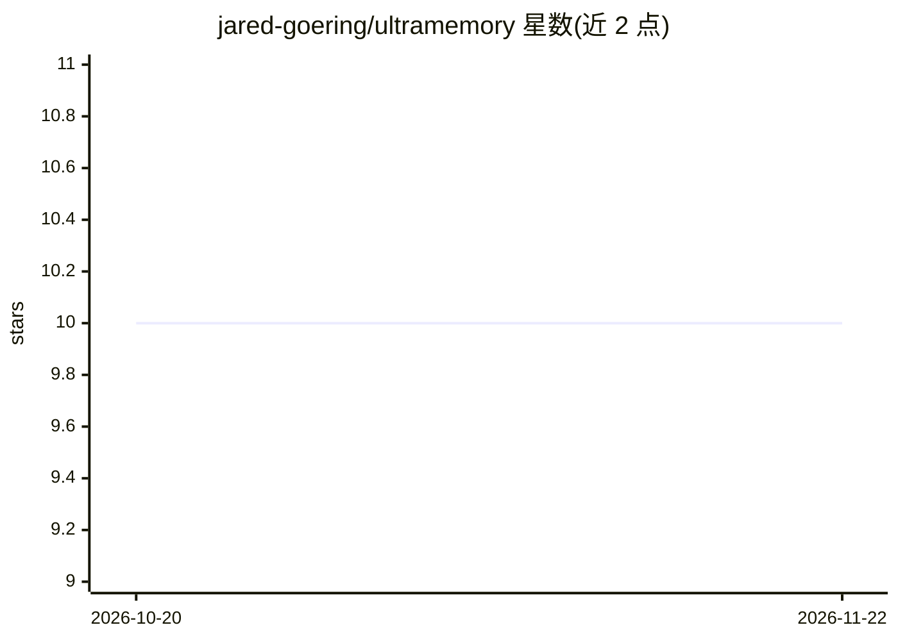

# jared-goering/ultramemory

⭐ 10 · Python · MIT · 推送 2026-03-30 · [GitHub](https://github.com/jared-goering/ultramemory) · 个人维护

**面向 AI agent 的本地优先记忆引擎：事实抽取、版本化与时间溯源**

以 SQLite + 本地嵌入运行的 Python 库/CLI/API 服务：从对话中用 LLM 抽取原子事实，通过关系版本化标记更新/扩展/矛盾关系并保留历史，区分事件日期与记录日期以支持时间查询。搜索默认零 LLM 调用（本地嵌入 + 余弦相似度，中位约 32ms），摄取每条需 2-3 次 LLM 调用；多 agent 通过 agent_id 共享同一记忆库。附 LongMemEval 基准自测结果与 3D 知识图谱可视化 UI。

## 筛选速览

| 维度 | 判定 | 备注 |
|---|---|---|
| AI 角色 | `ai-ecosystem` | LLM/agent 周边工具 |
| 许可风险 | `permissive` | MIT |
| 部署形态 | `library` | 以包/库形式分发 |
| 模型依赖 | — | README 未给出锁定关系 |
| 硬件要求 | — | 无带数字的原话,不猜 |
| 安装摩擦 | `low` | 无编译、无系统依赖或容器化 |
| 成熟度 | — | 结构信号不足 |

## 能力要点

- 关系版本化：旧事实标记为被取代但保留完整历史，支持 as-of 时间回溯查询
- 时间锚定：区分事件发生日期与记录日期
- 搜索零 LLM 调用，本地嵌入 + SQLite，无需 API key；摄取需 2-3 次有界 LLM 调用
- 多模态摄取（图片/音频/视频，需 Gemini 嵌入后端）与多 agent 共享记忆

## 适用场景

- 为多 agent 系统提供共享的长期记忆存储
- 需要追踪事实变更历史与时间线的问题回答
- 在无云依赖的本地环境中运行 agent 记忆库

## 场景标签

`Agent 记忆` · 领域:Agent 开发

## 证据(README 行号)

> L3:  Local-first memory engine for AI agents.
> L91: pip install ultramemory[local]   # includes local embeddings (no API needed for search)
> L207: Ultramemory uses a single SQLite database with `agent_id` tagging. Every agent writes to the same store, and searc

## 星数曲线

2026-10-20 10 → 2026-11-22 10（+0）

---
*卡片 v1 · prompt 1.4 · 生成 2026-11-19 · 置信度 mid · 依据 README sha `41cac483bb10` · [字段定义](../../DATASET.md)*
