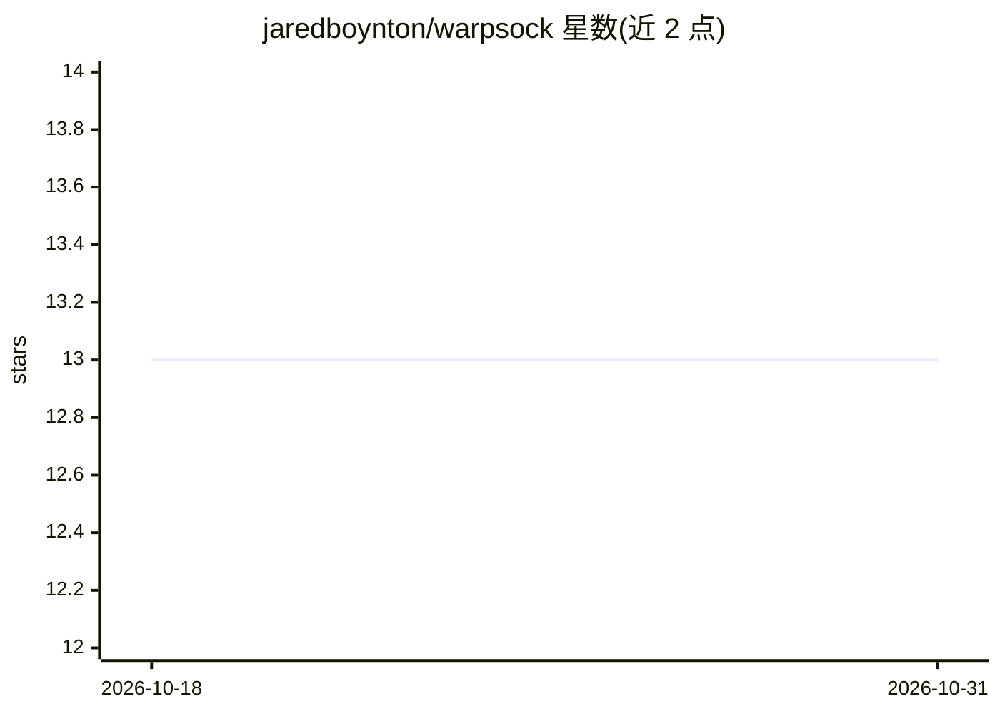

# jaredboynton/warpsock

⭐ 13 · Rust · 推送 2026-10-27 · [GitHub](https://github.com/jaredboynton/warpsock) · [官网](https://crates.io/crates/warpsock) · 个人维护

**Rust HTTP 客户端：以浏览器级指纹模拟访问，含 Node/Python 绑定**

用 Rust 编写的 HTTP 客户端库，在 TLS、HTTP/1.1、HTTP/2、HTTP/3 与 WebSocket 层面复现 Chrome/Firefox 浏览器指纹：TLS 采用 BoringSSL，HTTP/2 为基于 RFC 9113 的自研实现，已实现 Chrome 142-148、Firefox 133-151 及 ESR 指纹配置。默认不自动跟随重定向、不自动存 Cookie，可导入导出 Netscape 格式 Cookie；提供 Node 与 Python 绑定。附带针对 reqwest 0.12 的本地流式基准测试。前身为 Specter/Specters 包。

## 筛选速览

| 维度 | 判定 | 备注 |
|---|---|---|
| AI 角色 | `ai-ecosystem` | LLM/agent 周边工具 |
| 许可风险 | `none` | — |
| 部署形态 | `library` | 以包/库形式分发 |
| 模型依赖 | — | README 未给出锁定关系 |
| 硬件要求 | — | 无带数字的原话,不猜 |
| 安装摩擦 | `low` | 无编译、无系统依赖或容器化 |
| 成熟度 | — | 结构信号不足 |

## 能力要点

- 跨 TLS/HTTP1.1/HTTP2/HTTP3/WebSocket 的 Chrome 142-148 与 Firefox 133-151（含 ESR）指纹
- 自研 RFC 9113 HTTP/2 实现，TLS 使用 BoringSSL
- 提供 Rust crate 及 Node（npm）/Python（PyPI）绑定
- 支持 RFC 6455 WebSocket 与 RFC 8441 HTTP/2 Extended CONNECT

## 适用场景

- 需要 HTTP 层指纹与真实浏览器一致的抓取或自动化
- 对接 LLM 提供商 API 时复用带浏览器指纹的客户端
- 需要精细控制重定向、Cookie 与跨协议并发的请求场景

## 场景标签

`网页抓取` · 领域:效率与自动化

## 证据(README 行号)

> L238: The localhost results above hold up against a real production LLM endpoint. Warpsock ships a second bench, `benche
> L3: Rust HTTP client with Chrome-accurate fingerprints across TLS, HTTP/1.1, HTTP/2, HTTP/3, and WebSockets - automation

## 星数曲线

2026-10-18 13 → 2026-10-31 13（+0）

---
*卡片 v1 · prompt 1.4 · 生成 2026-10-31 · 置信度 low · 依据 README sha `f09a5afab2bf` · [字段定义](../../DATASET.md)*
