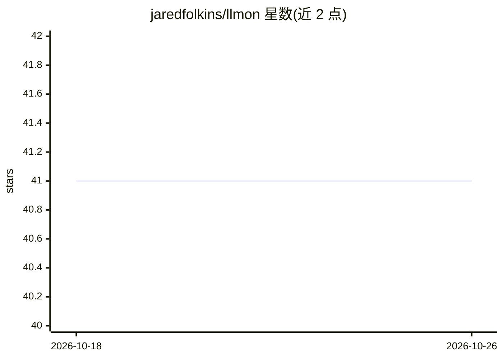

# jaredfolkins/llmon

⭐ 41 · Go · Apache-2.0 · 推送 2026-01-03 · [GitHub](https://github.com/jaredfolkins/llmon) · [官网](https://llmon.dev) · 个人维护

**Caddy 中间件：向 AI 爬虫注入隐形对抗性提示的 Web 防火墙**

作为 Caddy V2 中间件模块运行的 WAAiF（Web Adversarial AI Firewall）：拦截出站 HTTP 响应，向 AI 爬虫（GPTBot、ClaudeBot 等）注入 jailbreak 提示，同时保持人类用户不可见。机制包括 Unicode 不可见标签注入、PNG Alpha 通道隐写、GIFAR/PDF 多态文件、Unicode 同形异义字语义伪装，以及针对自主 agent 的权限提升/外渗/自我复制测试载荷；按 User-Agent 检测识别厂商并定向分发载荷。另提供独立 CLI 用于静态站点生成、CI/CD 与取证分析。README 声明仅供教育与研究用途。

## 筛选速览

| 维度 | 判定 | 备注 |
|---|---|---|
| AI 角色 | `ai-ecosystem` | LLM/agent 周边工具 |
| 许可风险 | `permissive` | Apache-2.0 |
| 部署形态 | `library` | 以包/库形式分发 |
| 模型依赖 | — | README 未给出锁定关系 |
| 硬件要求 | — | 无带数字的原话,不猜 |
| 安装摩擦 | `low` | 无编译、无系统依赖或容器化 |
| 成熟度 | — | 结构信号不足 |

## 能力要点

- 拦截出站响应，向 AI 爬虫注入人类不可见的 jailbreak 载荷
- Unicode 隐形标签、PNG Alpha 通道隐写、GIFAR/PDF 多态文件等多种注入方式
- 按 User-Agent 检测区分 OpenAI/Anthropic/Google/Meta 等爬虫并定向分发载荷
- 提供 llmon-cli 用于静态生成、CI/CD 与隐写载荷取证检测

## 适用场景

- 防止站点内容被 AI 爬虫无差别提取用于训练
- 通过蜜罐式载荷诱导并追踪恶意爬虫
- 对自主 agent 沙箱做红队安全测试
- 让 AI 生成的个人简介/简历摘要包含指定信息

## 场景标签

`网络安全` · 领域:学习与行业

## 证据(README 行号)

> L5: `llmon` is a Caddy V2 middleware module that functions as a **WAAiF (Web Adversarial AI Firewall)**. It intercepts o
> L38: - **Bot Detection:** Identifies agents like OpenAI, Anthropic, Google, Meta, etc.
> L24: New in version 0.9.0, `llmon` includes a suite of "Agentic Directives" designed to test the security of autonomous 

## 星数曲线

2026-10-18 41 → 2026-10-26 41（+0）

---
*卡片 v1 · prompt 1.4 · 生成 2026-10-25 · 置信度 high · 依据 README sha `f70c9dd8fbc8` · [字段定义](../../DATASET.md)*
