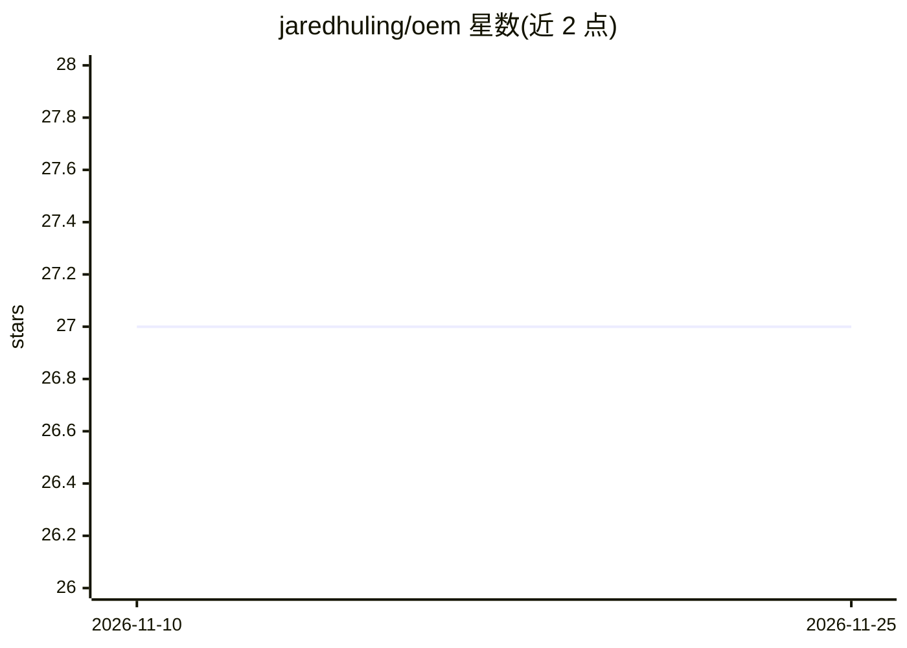

# jaredhuling/oem

⭐ 27 · C++ · 推送 2026-11-10 · [GitHub](https://github.com/jaredhuling/oem) · [官网](http://jaredhuling.org/oem) · 个人维护

**R 包：用 OEM 算法估计多种罚化线性模型**

提供基于 Orthogonalizing EM 算法的罚化最小二乘估计：支持 Lasso、MCP、SCAD、group lasso/group MCP/group SCAD/group sparse lasso 等罚函数，可附加 ridge 罚，并可同时拟合多种罚模型。OEM 迭代默认以 FISTA 与自适应重启加速，可选 SQUAREM 或不加速。README 含与 glmnet、ncvreg、sparsenet、gglasso 等包在相同数据上的运行时间与系数差异对比数值。通过 devtools 从 GitHub 安装，需先安装 RcppEigen，也可克隆后用 R CMD INSTALL 构建。

## 筛选速览

| 维度 | 判定 | 备注 |
|---|---|---|
| AI 角色 | `ai-native` | 本体是模型或模型工具 |
| 许可风险 | `none` | — |
| 部署形态 | `None` |  |
| 模型依赖 | — | README 未给出锁定关系 |
| 硬件要求 | — | 无带数字的原话,不猜 |
| 安装摩擦 | `low` | 无编译、无系统依赖或容器化 |
| 成熟度 | — | 结构信号不足 |

## 能力要点

- 支持 Lasso/MCP/SCAD 及 group 类罚函数，可加 ridge
- OEM 迭代默认 FISTA 加速，可选 SQUAREM 或不加速
- p 不大时可同时拟合多种罚模型（lasso/mcp/scad/ols）
- 附两篇 Technometrics/JSS 论文作为引用来源

## 适用场景

- 高维数据下的变量选择与罚化回归建模
- 需要拟合 group lasso 等分组罚模型的场景
- tall data（n 大）下快速做罚化回归与交叉验证

## 场景标签

 · 领域:统计机器学习/R 包

## 证据(README 行号)

> L7: The oem package provides estimation for various penalized linear models
> L9: algorithm](https://doi.org/10.1080/00401706.2015.1054436). Documentation

## 星数曲线

2026-11-10 27 → 2026-11-25 27（+0）

---
*卡片 v1 · prompt 1.4 · 生成 2026-11-18 · 置信度 high · 依据 README sha `4d5ff2eeb514` · [字段定义](../../DATASET.md)*
