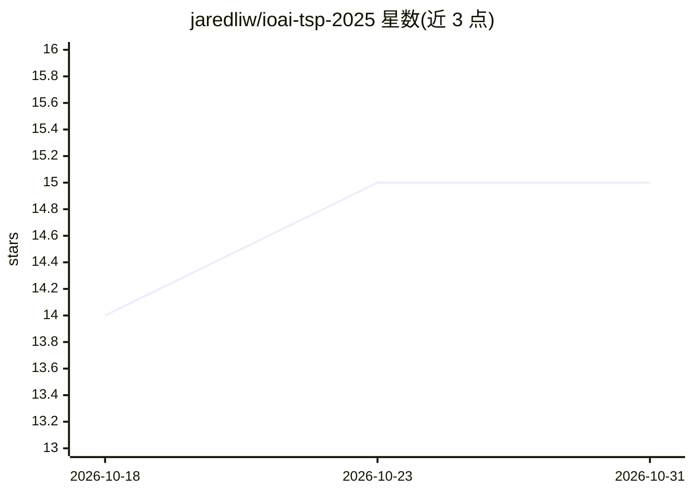

# jaredliw/ioai-tsp-2025

⭐ 15 · Jupyter Notebook · 推送 2026-07-31 · [GitHub](https://github.com/jaredliw/ioai-tsp-2025) · 组织维护

**马来西亚 IOAI 2025 训练与选拔项目仓库**

国际人工智能奥林匹克（IOAI）马来西亚队 2025 年训练与选拔项目的仓库。README 仅含标题一行，未提供课程内容、安装方式或使用说明。从仓库主题标签可见涉及机器学习、计算机视觉、NLP、LLM、PyTorch 与 sklearn 等方向，属训练/选拔资料性质，具体结构与机制无法从 README 验证。

## 筛选速览

| 维度 | 判定 | 备注 |
|---|---|---|
| AI 角色 | `ai-knowledge` | 知识聚合/清单类 |
| 许可风险 | `none` | — |
| 部署形态 | `None` |  |
| 模型依赖 | — | README 未给出锁定关系 |
| 硬件要求 | — | 无带数字的原话,不猜 |
| 安装摩擦 | `low` | 无编译、无系统依赖或容器化 |
| 成熟度 | — | 结构信号不足 |

## 能力要点

- 主题标签覆盖 CV、NLP、LLM、PyTorch、sklearn 等方向
- 对应 IOAI 马来西亚代表队 2025 年选拔

## 适用场景

- 参加 IOAI 马来西亚 2025 年训练与选拔

## 场景标签

`教程课程` · 领域:学习与行业

## 证据(README 行号)

> L1: # IOAI Training and Selection Programme 2025 - Malaysia

## 星数曲线

2026-10-18 14 → 2026-10-31 15（+1）

---
*卡片 v1 · prompt 1.4 · 生成 2026-10-30 · 置信度 low · 依据 README sha `51c8dd089f03` · [字段定义](../../DATASET.md)*
