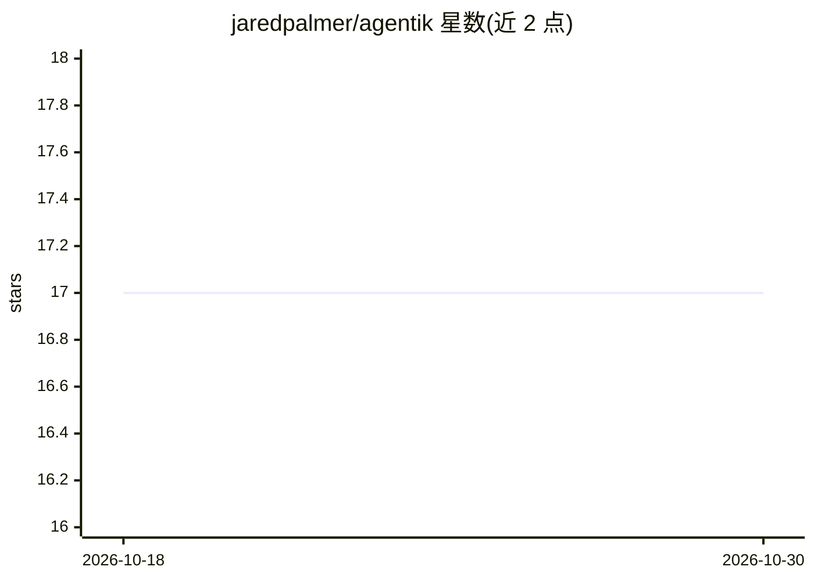

# jaredpalmer/agentik

⭐ 17 · TypeScript · MIT · 推送 2026-06-10 · [GitHub](https://github.com/jaredpalmer/agentik) · 个人维护

**基于 AI SDK v6 的可组合编码 agent 运行时与参考 CLI**

构建在 Vercel AI SDK v6 streamText 之上的模块化 agent 运行时：提供多轮推理与流式工具执行的 agent 循环、工具使用前后审批等生命周期钩子、转向/追加两级消息队列、可插拔 SessionStore 会话记录（含 JSONL 树状分支与压缩工具）、可选子代理委派与结构化事件流，内置 read/write/edit/grep/bash/webfetch 等工具。面向想嵌入编码 agent 的开发者；另附基于 OpenTUI 的参考 CLI。非自身实现模型，需外部提供 AI SDK 兼容的模型与 API key。

## 筛选速览

| 维度 | 判定 | 备注 |
|---|---|---|
| AI 角色 | `ai-ecosystem` | LLM/agent 周边工具 |
| 许可风险 | `permissive` | MIT |
| 部署形态 | `library` | 以包/库形式分发 |
| 模型依赖 | — | README 未给出锁定关系 |
| 硬件要求 | — | 无带数字的原话,不猜 |
| 安装摩擦 | `low` | 无编译、无系统依赖或容器化 |
| 成熟度 | — | 结构信号不足 |

## 能力要点

- 流式工具执行的 agent 循环与结构化事件流
- steering/follow-up 双消息队列，运行中可改向
- 可插拔 SessionStore、JSONL 树状会话与压缩工具
- 可选子代理（共享内存）与内置文件/bash/webfetch 工具

## 适用场景

- 把编码 agent 嵌入自己的产品，复用稳定运行时循环
- 构建审查 diff、输出可审计工具事件的 CI 助手
- 订阅运行时事件自建 TUI/Web 界面

## 场景标签

`Agent 框架` `编码 Agent` · 领域:Agent 开发

## 证据(README 行号)

> L3: Agentik is a composable runtime for building coding agents on top of AI SDK v6. It gives you a modular agent loop wi
> L27: - `@jaredpalmer/agentik` (`packages/runtime`): A modular agent loop built on AI SDK v6 `streamText` that owns tool 
> L32: `@jaredpalmer/agentik` is a modular agent loop built on AI SDK v6 `streamText` that owns tool execution and emits a

## 星数曲线

2026-10-18 17 → 2026-10-30 17（+0）

---
*卡片 v1 · prompt 1.4 · 生成 2026-10-29 · 置信度 high · 依据 README sha `0531c9c110fe` · [字段定义](../../DATASET.md)*
