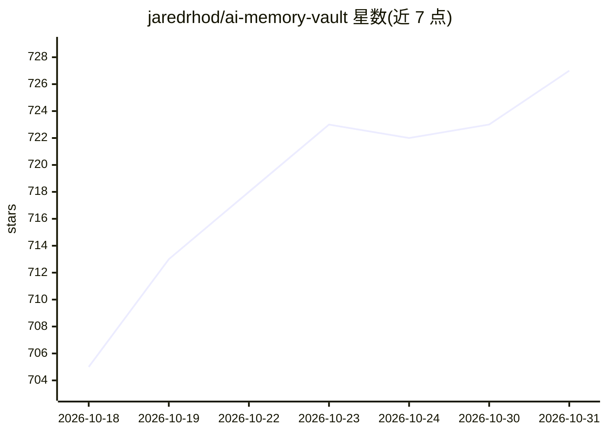

# jaredrhod/ai-memory-vault

⭐ 727 · CC-BY-SA-4.0 · 推送 2026-08-31 · [GitHub](https://github.com/jaredrhod/ai-memory-vault) · [官网](https://jaredrhod.com) · 个人维护

**把 Obsidian 仓库变成 AI 持久记忆的模板系统**

面向使用 Claude Code 等终端 AI 的个人开发者/用户：提供构建脚本 ai-memory-vault.md，在 Claude 会话内检查并安装 Obsidian、通过访谈生成自维护记忆系统——含引导配置 CLAUDE.md、文件夹结构、自动日记、随使用更新的个人档案与任务 Jobs。记忆以 Markdown 存于模型之外、无容量上限，AI 每次任务按需取用；另附 AI Priming 机制（任务前读取指定笔记）与一套预填的 agent 身份模板。无向量数据库，官方声明主要在 Claude Code 上构建测试，其他终端 AI 可用但有粗糙之处。

## 筛选速览

| 维度 | 判定 | 备注 |
|---|---|---|
| AI 角色 | `ai-ecosystem` | LLM/agent 周边工具 |
| 许可风险 | `viral` | CC-BY-SA-4.0 |
| 部署形态 | `None` |  |
| 模型依赖 | locked-api |  |
| 硬件要求 | — | 无带数字的原话,不猜 |
| 安装摩擦 | `low` | 无编译、无系统依赖或容器化 |
| 成熟度 | — | 结构信号不足 |

## 能力要点

- 构建脚本自动检查/安装 Obsidian 并访谈式生成完整记忆系统
- 记忆以 Markdown 存于模型外、无大小上限，一步取回所需内容
- AI Priming：每类任务自动读取指定笔记集后再输出
- 附带可替换的 agent 身份配置（名称/性格/规则）

## 适用场景

- 让 Claude Code 跨会话记住我的项目与偏好
- 用 Markdown 笔记组织 AI 的长期工作记忆
- 让 AI 在写邮件等任务前自动读取对应知识笔记

## 场景标签

`Agent 记忆` `知识库管理` · 领域:Agent 开发

## 证据(README 行号)

> L7: Give your AI a real, persistent memory. This is the free, open system that turns an Obsidian vault into your AI's wo
> L13: - **ai-memory-vault.md:** the build script. Run it inside Claude and it checks whether Obsidian is even installed y

## 星数曲线

2026-10-18 705 → 2026-10-31 727（+22）

---
*卡片 v1 · prompt 1.4 · 生成 2026-10-21 · 置信度 mid · 依据 README sha `b73ba7cfde99` · [字段定义](../../DATASET.md)*
