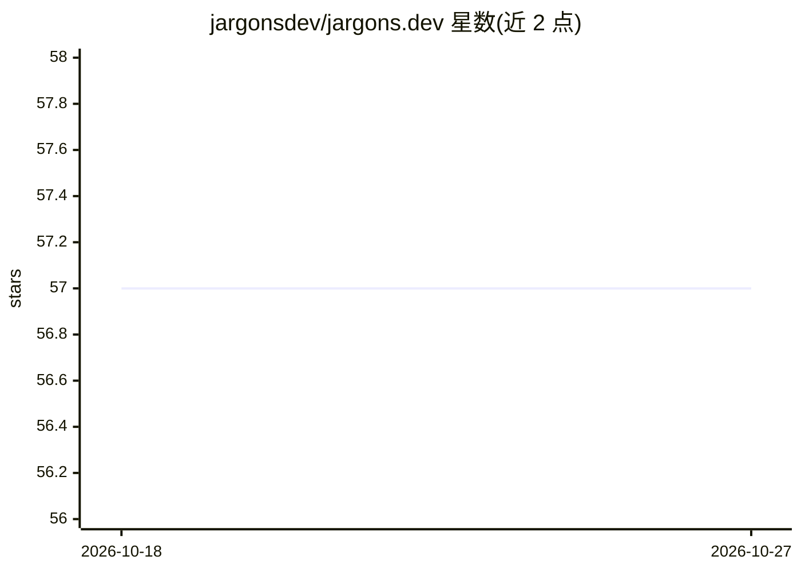

# jargonsdev/jargons.dev

⭐ 57 · MDX · GPL-2.0 · 推送 2026-08-13 · [GitHub](https://github.com/jargonsdev/jargons.dev) · [官网](https://jargons.dev) · 组织维护

**社区共建的软件工程术语词典网站，附 AI 助手**

开源社区协作维护的软件工程与技术术语词典，为各类水平读者提供简化释义与定义，基于 Astro 与 React 构建，采用岛屿架构。包含 ✨jAI AI 助手模块：先通过 npm run seed:jai 将词典内容注入向量库作为知识库，随后提供语义检索与交互式问答。本地运行需 Node.js 19+，执行 npm ci 与 setup 脚本创建 GitHub App 及环境文件后启动开发服务器。

## 筛选速览

| 维度 | 判定 | 备注 |
|---|---|---|
| AI 角色 | `ai-knowledge` | 知识聚合/清单类 |
| 许可风险 | `viral` | GPL-2.0 |
| 部署形态 | `None` |  |
| 模型依赖 | — | README 未给出锁定关系 |
| 硬件要求 | — | 无带数字的原话,不猜 |
| 安装摩擦 | `low` | 无编译、无系统依赖或容器化 |
| 成熟度 | — | 结构信号不足 |

## 能力要点

- 社区贡献者共同维护的术语释义内容
- ✨jAI 助手基于向量库内的词典内容提供语义检索
- 本地运行通过 setup 脚本自动创建 GitHub App 与 .env

## 适用场景

- 查找软件工程与技术术语的简化解释
- 通过 AI 助手以对话方式探索术语含义
- 作为贡献者参与词条共建

## 场景标签

`文档问答` · 领域:知识与检索

## 证据(README 行号)

> L9: <tt>jargons.dev</tt> is an open source dictionary curated by contributors providing simplified meaning and definitio
> L71: <tt>jargons.dev</tt> includes **✨jAI** (jargons.dev AI) - an intelligent assistant that helps users explore and und

## 星数曲线

2026-10-18 57 → 2026-10-27 57（+0）

---
*卡片 v1 · prompt 1.4 · 生成 2026-10-24 · 置信度 high · 依据 README sha `56b771e6bc13` · [字段定义](../../DATASET.md)*
