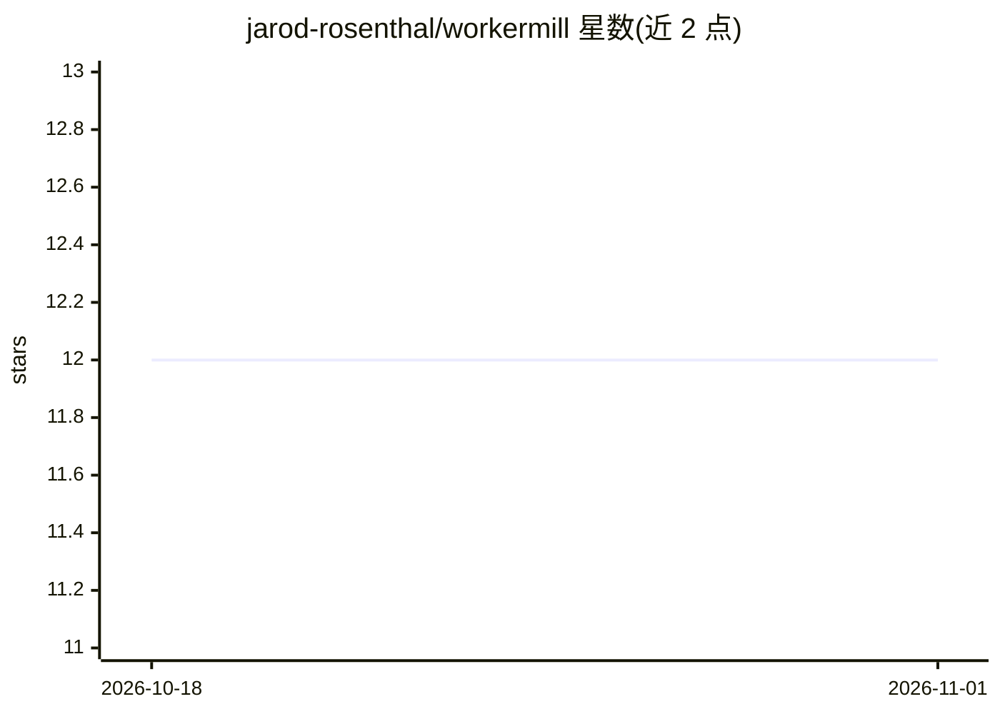

# jarod-rosenthal/workermill

⭐ 12 · TypeScript · Apache-2.0 · 推送 2026-09-09 · [GitHub](https://github.com/jarod-rosenthal/workermill) · [官网](https://workermill.com) · 个人维护

**多专家 AI 编码团队 CLI：规划、编码、评审并产出 PR**

基于 Node.js 的命令行编码代理：把任务分解为 stories，调度 planner、critic、专家 worker 与 reviewer 等角色，可按角色分别路由到 12 种提供商（Ollama 本地模型或云端 API），通过质量门禁后发布 PR。支持 GitHub Issues/Jira/Linear 工单来源、LSP 集成、MCP、自定义 persona 与技能命令、检查点回滚、/retry 断点续跑。README 明确声明未做对照评估，成本节省与质量等同性未验证。

## 筛选速览

| 维度 | 判定 | 备注 |
|---|---|---|
| AI 角色 | `ai-ecosystem` | LLM/agent 周边工具 |
| 许可风险 | `permissive` | Apache-2.0 |
| 部署形态 | `library` | 以包/库形式分发 |
| 模型依赖 | local-ok | 支持本地模型 |
| 硬件要求 | — | 无带数字的原话,不猜 |
| 安装摩擦 | `low` | 无编译、无系统依赖或容器化 |
| 成熟度 | — | 结构信号不足 |

## 能力要点

- 多角色编排：planner/critic/专家 worker/reviewer，按角色独立路由模型
- 12 种提供商支持，Ollama/LM Studio 本地模型可完全离线运行
- GitHub Issues/Jira/Linear 工单直接转 PR，/retry 跳过重规划续跑
- 11 个内置 persona，支持自定义 .md persona 与项目技能命令

## 适用场景

- 从工单或规格出发让 AI 团队规划并实现代码，最终产出 PR
- 用本地模型执行、云端模型规划评审以控制成本
- 对分支 diff 或 PR 运行独立的 Tech Lead 代码评审
- 派单个专家 persona 执行审计、写测试等专项任务

## 场景标签

`编码 Agent` `多智能体` `代码审查` · 领域:Agent 开发

## 证据(README 行号)

> L5: WorkerMill routes specialist AI personas to the providers you choose. Use local models for execution, cloud models f
> L46: Point WorkerMill at your GitHub Issues, Jira, or Linear tickets. It plans the work, assigns specialist AI personas 

## 星数曲线

2026-10-18 12 → 2026-11-01 12（+0）

---
*卡片 v1 · prompt 1.4 · 生成 2026-11-01 · 置信度 high · 依据 README sha `c595679bb558` · [字段定义](../../DATASET.md)*
