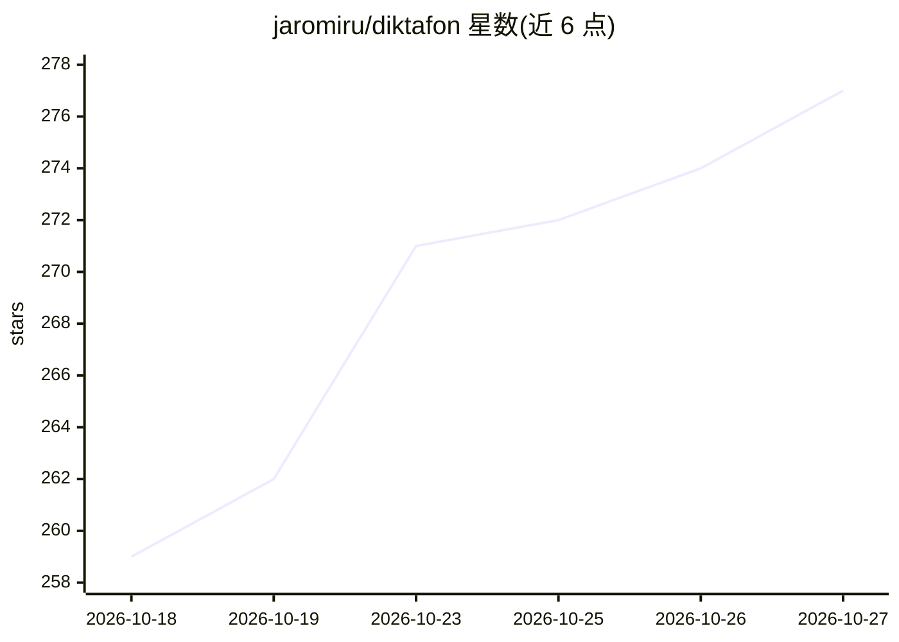

# jaromiru/diktafon

⭐ 277 · C++ · NOASSERTION · 推送 2026-07-30 · [GitHub](https://github.com/jaromiru/diktafon) · 个人维护

**本地转写与摘要的私密语音备忘录应用（卡带式组织）**

面向个人用户的语音备忘录应用：录音按主题组织成“卡带”，每条卡带作为一整盘连续磁带回放。设备端完成自动转写（Whisper）与摘要/自动命名（Qwen 模型），无账号、无云端、无分析数据外传；支持 20 种界面语言、口语自动检测、逐词点选跳转、语音活动检测抑制幻听词、整卡带导出导入。Android（F-Droid/Google Play）、iOS（App Store）与 Linux（tar.gz，需自行安装 libmpv2、pulseaudio-utils、ffmpeg 运行依赖）均提供安装包，也可用 Flutter 从源码构建，whisper.cpp 与 llama.cpp 以 vendored 方式随构建编译。

## 筛选速览

| 维度 | 判定 | 备注 |
|---|---|---|
| AI 角色 | `ai-enhanced` | 去掉 AI 部分产品仍成立 |
| 许可风险 | `none` | NOASSERTION |
| 部署形态 | `desktop` | 安装包/桌面程序 |
| 模型依赖 | — | README 未给出锁定关系 |
| 硬件要求 | — | 无带数字的原话,不猜 |
| 安装摩擦 | `high` | 编译与系统依赖俱全 |
| 成熟度 | — | 结构信号不足 |

## 能力要点

- 设备端 Whisper 转写 + Qwen 摘要与自动命名，模型首次运行时下载、可在设置中切换
- 语音活动检测与低频滤波，避免噪音/静音产生幻听词
- 转写文本逐词点选跳转到对应音频位置
- 卡带级整体摘要、单条备忘 gist、未命名卡带自动拟题

## 适用场景

- 随手录语音备忘，事后靠转写文本搜索和定位
- 在无网络、注重隐私的环境下录音并自动生成摘要
- 把某个主题的多次录音整理成一盘可连续回放的卡带

## 场景标签

`语音识别` · 领域:感知与多模态

## 证据(README 行号)

> L13: Diktafon is a voice-memo app built around one idea: capturing a thought and
> L65: - **On-device models** — transcription by Whisper, summaries by Qwen. Models

## 星数曲线

2026-10-18 259 → 2026-10-27 277（+18）

---
*卡片 v1 · prompt 1.4 · 生成 2026-10-22 · 置信度 high · 依据 README sha `f909ff9acf1c` · [字段定义](../../DATASET.md)*
