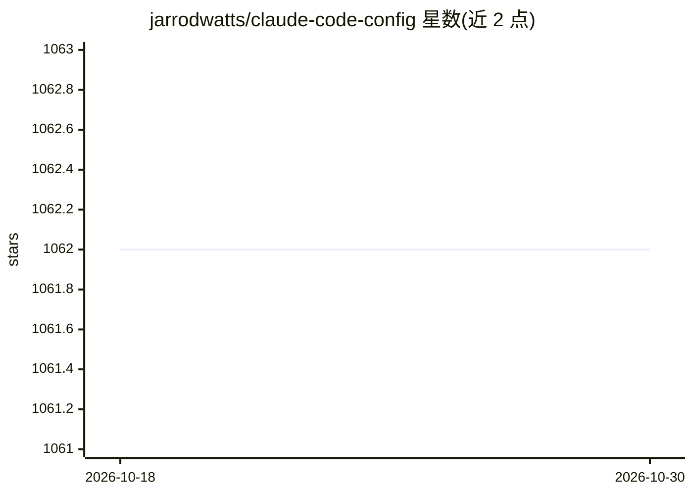

# jarrodwatts/claude-code-config

⭐ 1,062 · JavaScript · 推送 2026-01-21 · [GitHub](https://github.com/jarrodwatts/claude-code-config) · 个人维护

**Claude Code 个人配置集：规则、技能、子代理、命令与钩子**

Jarrod Watts 维护的个人 Claude Code 配置仓库，内容多取自社区：包含按路径作用域加载的规则（TypeScript、测试、注释、Foundry/Solidity）、模型自动调用的技能、codebase-search 等 4 个子代理、interview 斜杠命令、3 个事件钩子脚本，以及 CLAUDE.md 全局指令。提供三种安装方式：粘贴 INSTALL.md 提示词、整仓 git clone 到 ~/.claude、或选择性拷贝。另列出推荐的官方插件与 claude-hud 状态栏插件的 CLI 安装命令。

## 筛选速览

| 维度 | 判定 | 备注 |
|---|---|---|
| AI 角色 | `ai-ecosystem` | LLM/agent 周边工具 |
| 许可风险 | `none` | — |
| 部署形态 | `None` |  |
| 模型依赖 | — | README 未给出锁定关系 |
| 硬件要求 | — | 无带数字的原话,不猜 |
| 安装摩擦 | `low` | 无编译、无系统依赖或容器化 |
| 成熟度 | — | 结构信号不足 |

## 能力要点

- 路径作用域规则文件（TypeScript/测试/注释/Solidity）
- 4 个子代理（codebase-search、media-interpreter 等）与 interview 命令
- 3 个事件钩子脚本（UserPromptSubmit/PostToolUse/Stop）
- 三种安装方式：粘贴提示词、git clone、选择性拷贝

## 适用场景

- 直接套用现成的 Claude Code 规则与子代理配置
- 参考社区配置组织自己的 dotfiles
- 按需拷贝单个规则或代理文件到已有配置

## 场景标签

`提示工程` · 领域:Agent 开发

## 证据(README 行号)

> L3: my personal claude code configuration - mostly not created by me, but sourced from many talented people in the commu
> L28: ### Rules (`.claude/rules/`)
> L47: ### Agents (`.claude/agents/`)

## 星数曲线

2026-10-18 1,062 → 2026-10-30 1,062（+0）

---
*卡片 v1 · prompt 1.4 · 生成 2026-10-21 · 置信度 high · 依据 README sha `51e328ebe454` · [字段定义](../../DATASET.md)*
