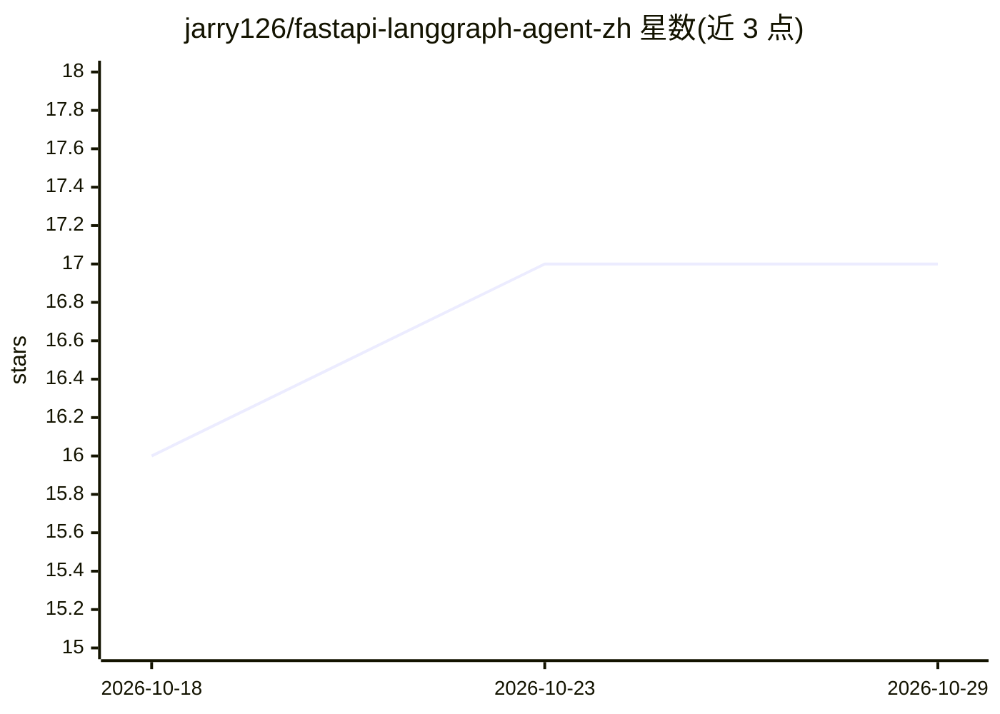

# jarry126/fastapi-langgraph-agent-zh

⭐ 17 · Python · MIT · 推送 2026-05-19 · [GitHub](https://github.com/jarry126/fastapi-langgraph-agent-zh) · 个人维护 · 中文 README

**面向国内开发者的 LangGraph+FastAPI 生产级智能体模板**

基于 fastapi-langgraph-agent-production-ready-template 的中文适配模板：用 FastAPI 提供 REST API，LangGraph 做 Agent 工作流编排，LangChain+tenacity 处理 LLM 调用重试与 Fallback；对接阿里云 DashScope（Qwen LLM + qwen-embedding），长期记忆采用 mem0+pgvector，持久化用 PostgreSQL+SQLModel，附带 JWT 鉴权、按用户 ID 限流、structlog 日志、Prometheus/Grafana 监控与 Langfuse 追踪。相对原项目改动包括认证简化、embedding 方案替换为阿里云、日志重构与限流策略调整。需 Python 3.11+ 与 PostgreSQL 15+（pgvector、pg_jieba 扩展），用 uv 安装依赖、make 命令启动。

## 筛选速览

| 维度 | 判定 | 备注 |
|---|---|---|
| AI 角色 | `ai-ecosystem` | LLM/agent 周边工具 |
| 许可风险 | `permissive` | MIT |
| 部署形态 | `self-host` | docker 或自建部署 |
| 模型依赖 | — | README 未给出锁定关系 |
| 硬件要求 | — | 无带数字的原话,不猜 |
| 安装摩擦 | `low` | 无编译、无系统依赖或容器化 |
| 成熟度 | — | 结构信号不足 |

## 能力要点

- LangGraph 工作流编排 + FastAPI 异步 REST API
- 对接阿里云 DashScope（Qwen LLM + qwen-embedding）
- mem0 + pgvector 长期记忆与 pg_jieba 中文分词
- JWT 鉴权、按用户 ID 限流、Prometheus/Grafana/Langfuse 观测链路

## 适用场景

- 国内团队以它为起点搭建 AI Agent 应用
- 需要长期记忆与中文语义检索的多轮对话服务
- 需要鉴权、限流、监控等生产配套设施的 Agent 项目

## 场景标签

`Agent 框架` · 领域:Agent 开发

## 证据(README 行号)

> L3: > 基于 fastapi-langgraph-agent-production-ready-template 的中文适配版本，面向国内开发者的生产级 LangGraph 工作流编排框架。
> L7: 本项目是一个开箱即用的 **LangGraph + FastAPI 生产级智能体模板**，适合作为国内团队构建 AI Agent 应用的起点。
> L20: |AI Agent 工作流编排|LangGraph（StateGraph + 工具调用）|

## 星数曲线

2026-10-18 16 → 2026-10-29 17（+1）

---
*卡片 v1 · prompt 1.4 · 生成 2026-10-29 · 置信度 mid · 依据 README sha `80c9c66e0fdf` · [字段定义](../../DATASET.md)*
