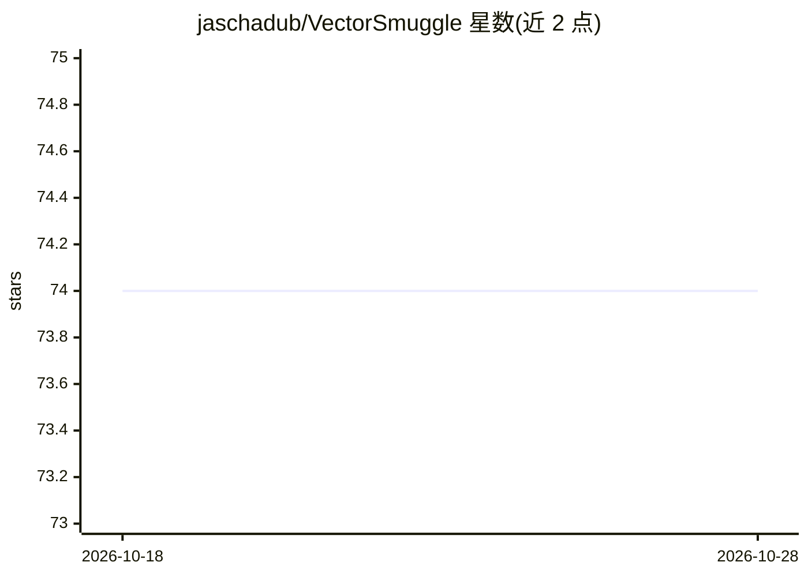

# jaschadub/VectorSmuggle

⭐ 74 · Python · NOASSERTION · 推送 2026-05-19 · [GitHub](https://github.com/jaschadub/VectorSmuggle) · [官网](https://vectorsmuggle.org) · 个人维护

**量化嵌入隐写数据渗出与统计检测失效的研究框架**

面向安全研究者的研究框架：在 RAG 嵌入存储中实现隐写式数据隐藏（噪声注入、旋转、缩放、分片、诱饵交织等），并以 Isolation Forest / One-Class SVM 为检测方进行对抗性实证评估；支持 15+ 文档格式摄取、FAISS/Chroma/Qdrant 多后端与 OpenAI 加四个 Ollama 本地嵌入模型的多模型研究。配套 VectorPin 防御：以 Ed25519 对嵌入签名，任何嵌入后修改均破坏签名验证。README 明确声明不评估商业 DLP 产品、未验证生产规模与真实攻击者行为，仅供教育性与伦理安全研究。

## 筛选速览

| 维度 | 判定 | 备注 |
|---|---|---|
| AI 角色 | `ai-ecosystem` | LLM/agent 周边工具 |
| 许可风险 | `permissive` | NOASSERTION |
| 部署形态 | `self-host` | docker 或自建部署 |
| 模型依赖 | local-ok | 支持本地模型 |
| 硬件要求 | — | 无带数字的原话,不猜 |
| 安装摩擦 | `low` | 无编译、无系统依赖或容器化 |
| 成熟度 | — | 结构信号不足 |

## 能力要点

- 多种嵌入隐写技术与 Isolation Forest / One-Class SVM 检测对抗实证
- 多后端（FAISS/Chroma/Qdrant）与多嵌入模型（OpenAI + 4 个 Ollama 本地模型）评估
- VectorPin 防御：Ed25519 对嵌入做密码学溯源签名
- 提供 Colab 一键复现 demo 与配套 arXiv 预印本

## 适用场景

- 红队演练与蓝队检测器开发中研究向量渗出风险
- 学术上复现论文的检测 AUC 与信道容量实验
- 评估新型检测器设计对隐写技术目录的表现

## 场景标签

`网络安全` `科研工具` · 领域:学习与行业

## 证据(README 行号)

> L5: A research framework demonstrating vector-based data exfiltration techniques in AI/ML environments. This project exa
> L25: VectorSmuggle investigates how sensitive information can be hidden within seemingly legitimate vector embeddings, s

## 星数曲线

2026-10-18 74 → 2026-10-28 74（+0）

---
*卡片 v1 · prompt 1.4 · 生成 2026-10-24 · 置信度 mid · 依据 README sha `c53853b05de4` · [字段定义](../../DATASET.md)*
