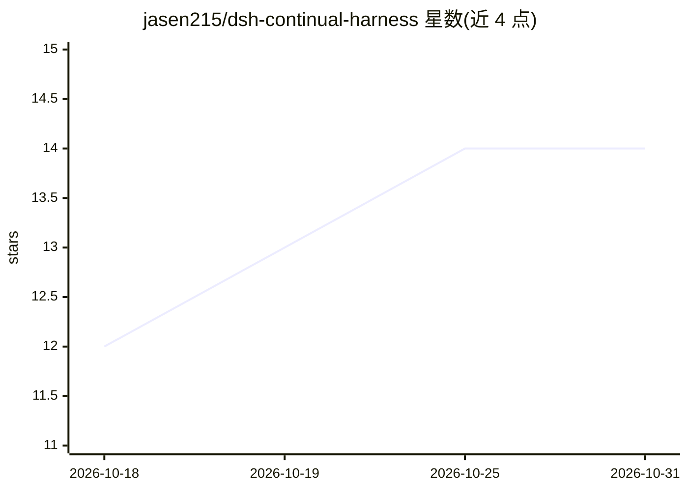

# jasen215/dsh-continual-harness

⭐ 14 · TypeScript · MIT · 推送 2026-10-14 · [GitHub](https://github.com/jasen215/dsh-continual-harness) · 个人维护 · 中文 README

**DeepSeek Harness 插件：为 AI agent 提供持续学习与持久记忆**

面向 DeepSeek Harness（DSH）运行时的 npm 插件，为编码 agent 附加持续学习能力：通过 harness_state.json 与 refinements.jsonl 实现跨会话持久记忆与经验沉淀（ESP 协议），在会话事件上自动执行 LLM 复审→规划→应用→回滚闭环，并按排名将记忆注入模型上下文。提供 harness_refine 工具与 /refine 命令两个精炼入口，写入路径经治理护栏（影响最小化、合法性硬拒、必要性软门）约束。附带 A/B 基准工具 harness_benchmark，冻结用例对参考/候选两侧运行，决策由代码而非模型给出。经 dsh 0.1.5-rc.1 至 0.2.0-rc.2 版本测试。

## 筛选速览

| 维度 | 判定 | 备注 |
|---|---|---|
| AI 角色 | `ai-ecosystem` | LLM/agent 周边工具 |
| 许可风险 | `permissive` | MIT |
| 部署形态 | `library` | 以包/库形式分发 |
| 模型依赖 | locked-api |  |
| 硬件要求 | — | 无带数字的原话,不猜 |
| 安装摩擦 | `low` | 无编译、无系统依赖或容器化 |
| 成熟度 | — | 结构信号不足 |

## 能力要点

- 跨会话持久状态（ESP 协议：prompt/memory/skill/subagent 四类条目）与按 id 回滚的追加式精炼历史
- 会话事件触发的自动复审-规划-应用闭环，可配置轮次间隔与冷却
- 排名注入机制：标题匹配优先于内容匹配，按类别设上限
- harness_benchmark 冻结用例 A/B 基准，决策由代码（src/score.ts）给出

## 适用场景

- 让 DSH 编码 agent 在多次会话间保留并复用经验与技能
- 对 agent 记忆做定期复审、精炼与按 id 回滚
- 用冻结用例 A/B 基准验证一次精炼是否引入回归

## 场景标签

`Agent 记忆` · 领域:Agent 开发

## 证据(README 行号)

> L12: A **DeepSeek Harness (DSH) plugin for self-improving AI agents**, providing continual learning through persistent m
> L18: A single npm package (`dsh-continual-harness`) takes effect through the following extension points once mounted:
> L65: Any dsh plugin can read and write experience through this protocol (write state files, append history, publish even

## 星数曲线

2026-10-18 12 → 2026-10-31 14（+2）

---
*卡片 v1 · prompt 1.4 · 生成 2026-10-31 · 置信度 high · 依据 README sha `59a69cc1c031` · [字段定义](../../DATASET.md)*
