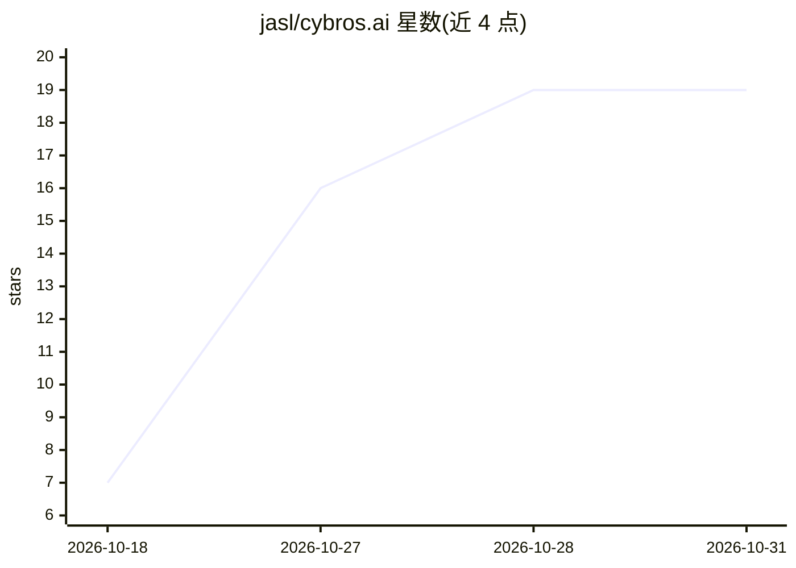

# jasl/cybros.ai

⭐ 19 · Ruby · NOASSERTION · 推送 2026-10-27 · [GitHub](https://github.com/jasl/cybros.ai) · [官网](https://cybros.pages.dev/) · 个人维护

**面向专业用户与小团队的自托管 agent 内核平台**

自托管 agent 平台，含三部分：Nexus 内核（成员账户、持久会话、跨提供商的模型网关、审批、调度、记忆、用量核算与保留策略）；rho 默认 agent（浏览器/Telegram/编辑器中的个人助手兼编码 agent）；Runners 在用户机器上执行工具。支持 API key、订阅授权或本地端点接入模型。安装需 Docker Compose，通过 curl 脚本一键部署，无需宿主 Ruby/JS 运行时。提供 Ruby/TypeScript/Rust SDK 用于构建自有 agent。采用滚动发布，接口与数据库模式仍可能不兼容变更。

## 筛选速览

| 维度 | 判定 | 备注 |
|---|---|---|
| AI 角色 | `ai-ecosystem` | LLM/agent 周边工具 |
| 许可风险 | `none` | NOASSERTION |
| 部署形态 | `library` | 以包/库形式分发 |
| 模型依赖 | — | README 未给出锁定关系 |
| 硬件要求 | — | 无带数字的原话,不猜 |
| 安装摩擦 | `low` | 无编译、无系统依赖或容器化 |
| 成熟度 | `idea` | |

## 能力要点

- Nexus 内核提供模型网关、审批、调度、记忆与用量核算
- rho 默认 agent 兼作参考实现，基于公开 API 构建自有 agent
- Runners 在工作站/服务器/容器执行工具，仅向 Nexus 外拨连接
- 提供 Ruby/TypeScript/Rust 三种 SDK

## 适用场景

- 在自有机器上运行一个开箱可用的个人助手与编码 agent
- 小团队自建 agent 平台并统一管理模型接入与用量
- 基于公开 API 与 SDK 构建自定义 agent

## 场景标签

`模型网关` `AI 助手` `编码 Agent` `Agent 框架` · 领域:Agent 开发

## 证据(README 行号)

> L6: - **Nexus**, the kernel, keeps one account of human and agent members, durable
> L7:  conversations and runs, a model gateway across providers, tool delivery to
> L11:  your projects through a runner. It is built only on Nexus's public APIs, so it

## 星数曲线

2026-10-18 7 → 2026-10-31 19（+12）

---
*卡片 v1 · prompt 1.4 · 生成 2026-10-28 · 置信度 mid · 依据 README sha `ad2c9e6e54bd` · [字段定义](../../DATASET.md)*
