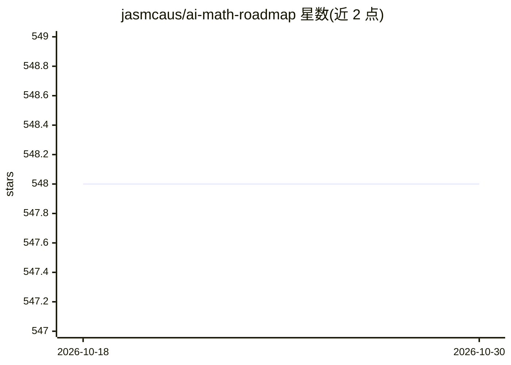

# jasmcaus/ai-math-roadmap

⭐ 548 · MIT · 推送 2025-11-07 · [GitHub](https://github.com/jasmcaus/ai-math-roadmap) · 个人维护

**面向 AI 从业者的数学知识学习路线图（Markdown 教程）**

由个人开发者维护的 Markdown 学习指南，梳理从事 AI/数据科学所需的数学基础，按代数、线性代数、微积分、统计与概率、信息论五大主题组织，每类列出具体概念条目（如特征值、梯度下降、贝叶斯定理、KL 散度等）。内容以概念清单形式呈现，不提供安装运行方式，仅作为阅读材料使用，以 MIT 许可公开。

## 筛选速览

| 维度 | 判定 | 备注 |
|---|---|---|
| AI 角色 | `ai-knowledge` | 知识聚合/清单类 |
| 许可风险 | `permissive` | MIT |
| 部署形态 | `None` |  |
| 模型依赖 | — | README 未给出锁定关系 |
| 硬件要求 | — | 无带数字的原话,不猜 |
| 安装摩擦 | `low` | 无编译、无系统依赖或容器化 |
| 成熟度 | — | 结构信号不足 |

## 能力要点

- 覆盖代数/线性代数/微积分/统计与概率/信息论五大主题
- 每主题列出核心概念条目（PCA、Hessian、MLE、Viterbi 等）
- MIT License 公开，纯 Markdown 阅读

## 适用场景

- 初学者按清单规划 AI 所需数学的学习顺序
- 从业者快速回顾不熟悉的数学概念
- 查找 AI 各环节对应的数学知识点

## 场景标签

`教程课程` · 领域:学习与行业

## 证据(README 行号)

> L4:  AI Math Roadmap
> L19: And this is one of the reasons that puts off many beginners. After much research and talks with several veterans in

## 星数曲线

2026-10-18 548 → 2026-10-30 548（+0）

---
*卡片 v1 · prompt 1.4 · 生成 2026-10-21 · 置信度 high · 依据 README sha `8db105e8b74e` · [字段定义](../../DATASET.md)*
