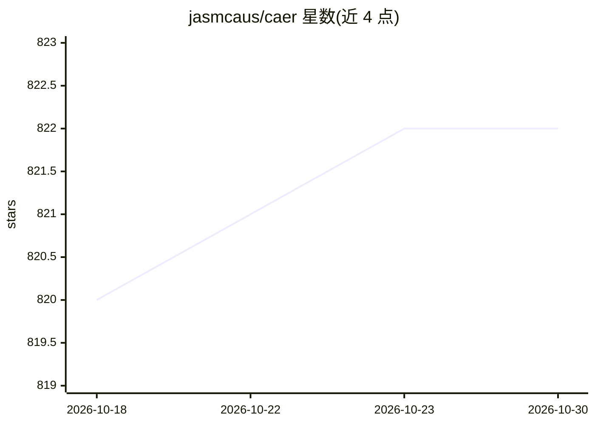

# jasmcaus/caer

⭐ 822 · Python · MIT · 推送 2026-10-25 · [GitHub](https://github.com/jasmcaus/caer) · [官网](https://caer.readthedocs.io) · 个人维护

**轻量级 GPU 加速的 Python 计算机视觉库，简化研究原型开发**

面向深度学习与计算机视觉研究者的 Python 视觉库，定位为减少样板代码、加快模型与研究想法原型验证。组件覆盖色彩空间操作、图像预处理、图像变换与增广、视频处理、路径操作及自带测试图像数据。README 称其可作为 OpenCV 的 GPU 加速替代使用，或作为计算机视觉研究平台。支持 Python 3.6 以上版本，经 pip 安装，MIT 许可。

## 筛选速览

| 维度 | 判定 | 备注 |
|---|---|---|
| AI 角色 | `ai-native` | 本体是模型或模型工具 |
| 许可风险 | `permissive` | MIT |
| 部署形态 | `library` | 以包/库形式分发 |
| 模型依赖 | — | README 未给出锁定关系 |
| 硬件要求 | — | 无带数字的原话,不猜 |
| 安装摩擦 | `low` | 无编译、无系统依赖或容器化 |
| 成熟度 | — | 结构信号不足 |

## 能力要点

- GPU 加速的计算机视觉库（caer 主组件）
- 覆盖 color/preprocessing/transforms/video 等组件与自带测试图像
- 类型检查的 API 设计，README 称可替代 OpenCV 使用 GPU

## 适用场景

- 计算机视觉研究中快速原型验证
- 作为 OpenCV 的 GPU 加速替代进行图像与视频处理
- 图像预处理与数据增广流水线

## 场景标签

`图像视频处理` · 领域:感知与多模态

## 证据(README 行号)

> L12: Caer is a _lightweight, high-performance_ Vision library for high-performance AI research. We wrote this framework 
> L22: |**caer**|A lightweight GPU-accelerated Computer Vision library for high-performance AI research|

## 星数曲线

2026-10-18 820 → 2026-10-30 822（+2）

---
*卡片 v1 · prompt 1.4 · 生成 2026-10-21 · 置信度 high · 依据 README sha `f1f9124dac85` · [字段定义](../../DATASET.md)*
