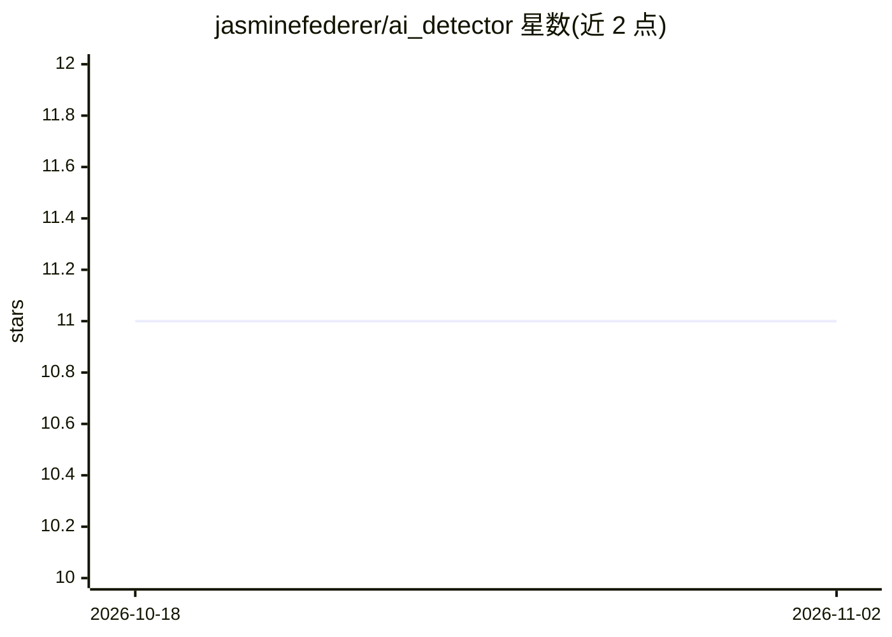

# jasminefederer/ai_detector

⭐ 11 · Python · 推送 2026-04-05 · [GitHub](https://github.com/jasminefederer/ai_detector) · 个人维护

**检测收到的 Outlook 邮件是否由 ChatGPT 撰写的 Python 脚本**

Python 脚本，监控 Microsoft Outlook 收件箱，对每封新邮件调用 OpenAI 的 AI 文本分类器（ai-text-classifier），输出该邮件由 AI 生成的概率及五档可能性标签（very unlikely 到 likely，0%-100%）。使用前需从 OpenAI 平台手动提取 Bearer token 存入 my_token.txt 文件，通过 pip install -r requirements.txt 安装依赖后运行 listener.py。仅支持 Outlook，需 Python 与 pip 环境。

## 筛选速览

| 维度 | 判定 | 备注 |
|---|---|---|
| AI 角色 | `ai-native` | 本体是模型或模型工具 |
| 许可风险 | `none` | — |
| 部署形态 | `library` | 以包/库形式分发 |
| 模型依赖 | — | README 未给出锁定关系 |
| 硬件要求 | — | 无带数字的原话,不猜 |
| 安装摩擦 | `low` | 无编译、无系统依赖或容器化 |
| 成熟度 | — | 结构信号不足 |

## 能力要点

- 对新到 Outlook 邮件逐封给出 AI 生成概率与五档可能性标签
- 调用 OpenAI ai-text-classifier 接口进行检测
- 输出发件人、主题行与 AI 生成概率

## 适用场景

- 收到邮件时判断对方是否用 ChatGPT 代写
- 对 Outlook 收件箱做 AI 生成内容的概率提示

## 场景标签

 · 领域:AI 检测/邮件工具

## 证据(README 行号)

> L3: Discover if someone is sending you an email using ChatGPT! With each new email, this script will give you the likeli
> L40: the probability this email was generated by AI

## 星数曲线

2026-10-18 11 → 2026-11-02 11（+0）

---
*卡片 v1 · prompt 1.4 · 生成 2026-11-02 · 置信度 mid · 依据 README sha `7ad665a507f9` · [字段定义](../../DATASET.md)*
