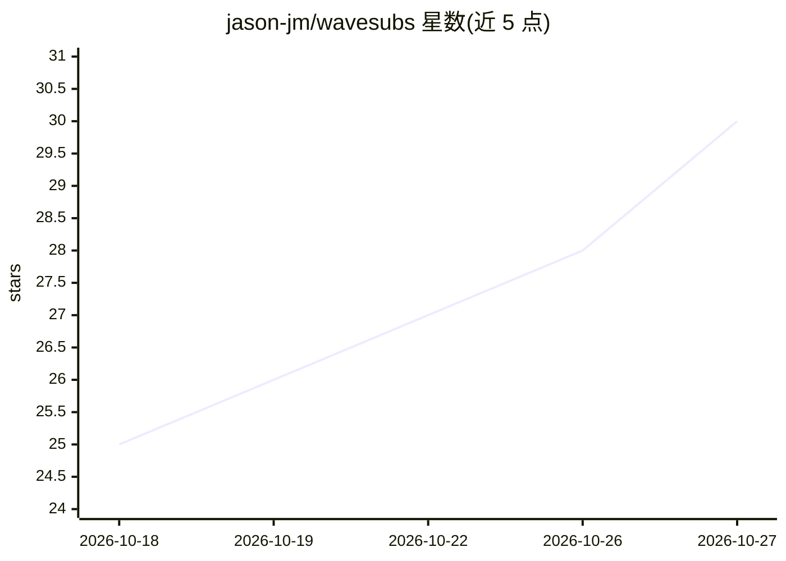

# jason-jm/wavesubs

⭐ 30 · TypeScript · MIT · 推送 2026-09-27 · [GitHub](https://github.com/jason-jm/wavesubs) · [官网](https://wavesubs.com) · 个人维护 · 中文 README

**本地 AI 视频字幕生成与翻译工具（macOS/Windows 桌面应用）**

面向个人用户的 Electron 桌面应用：读取任意 ffmpeg 可解的视频/音频文件，用 whisper.cpp（Apple Silicon 上 Metal 加速）在本地识别语音并生成 SRT/ASS 字幕，再经本地 Qwen3 模型（通过 llama.cpp，应用内下载）或 OpenAI 兼容云端 API 翻译至 29 种目标语言。时间轴用 Silero VAD 与响度分析对齐，可读取内嵌字幕轨或 18 种外部字幕格式，另支持画面文字（系统 OCR）识别翻译、带视频预览的字幕编辑器、逐文件质量报告与整季批量处理。全部处理在本地进行，不上传视频。

## 筛选速览

| 维度 | 判定 | 备注 |
|---|---|---|
| AI 角色 | `ai-native` | 本体是模型或模型工具 |
| 许可风险 | `permissive` | MIT |
| 部署形态 | `desktop` | 安装包/桌面程序 |
| 模型依赖 | — | README 未给出锁定关系 |
| 硬件要求 | — | 无带数字的原话,不猜 |
| 安装摩擦 | `medium` | 含编译或系统依赖之一 |
| 成熟度 | — | 结构信号不足 |

## 能力要点

- whisper.cpp 本地语音识别（Tiny–Large v3，自动语言检测），两小时影片在 M 系列 Mac 上约 3–6 分钟
- Qwen3 1.7B–32B 通过 llama.cpp 本地翻译，或接入 OpenAI 兼容云端 API
- 画面文字（OP/ED 除外）经系统 OCR（Vision / Windows.Media.Ocr）识别并翻译排版
- 逐文件质量报告与按文件身份+参数缓存的识别结果复用

## 适用场景

- 为找不到字幕的视频或整季剧集生成 SRT/ASS 字幕
- 离线把外语对白翻译成中文等 29 种语言，含双语输出
- 翻译画面上的标志、短信、标题卡等 on-screen text
- 在带视频预览的编辑器中校对时间轴与译文

## 场景标签

`语音识别` `OCR` · 领域:感知与多模态

## 证据(README 行号)

> L18: 2. **Local AI recognizes the dialogue and aligns it.** whisper.cpp recognizes the speech on your machine with autom
> L40: - **Local by default.** Qwen3 models from 1.7B to 32B run on your machine through llama.cpp, downloaded inside the 

## 星数曲线

2026-10-18 25 → 2026-10-27 30（+5）

---
*卡片 v1 · prompt 1.4 · 生成 2026-10-26 · 置信度 high · 依据 README sha `6f8a5bc967ca` · [字段定义](../../DATASET.md)*
