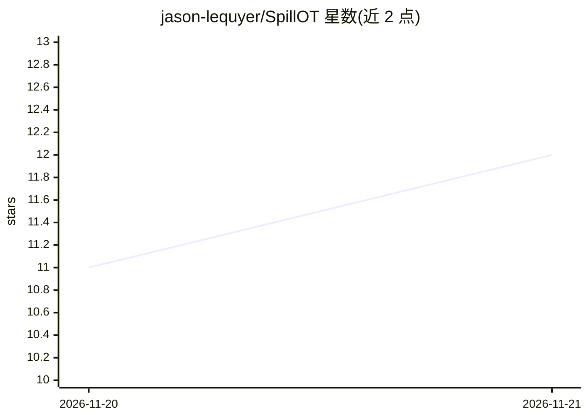

# jason-lequyer/SpillOT

⭐ 12 · Python · Apache-2.0 · 推送 2026-11-18 · [GitHub](https://github.com/jason-lequyer/SpillOT) · [官网](https://jason-lequyer.github.io/SpillOT/) · 个人维护

**给显微多重成像研究者做通道串扰去除与去噪的工具包**

面向高多重成像（如 IMC、Opal/Vectra）的串扰去除与去噪工具包，提供 Fiji 插件与 Python 命令行两种形态。用户指定哪些通道疑似渗漏到目标通道后，工具仅在结构块相似性检测到局部匹配处移除信号，而非全局线性扣除。 Fiji 插件通过 conda 环境调用后端脚本；命令行可在工作站/集群运行，支持手动串扰矩阵 CSV、patch size 与过曝像素参数。去噪器基于 PyTorch，非 Fiji 插件的一部分，GPU 下运行并附 PSNR/SSIM 评估脚本。

## 筛选速览

| 维度 | 判定 | 备注 |
|---|---|---|
| AI 角色 | `ai-native` | 本体是模型或模型工具 |
| 许可风险 | `permissive` | Apache-2.0 |
| 部署形态 | `None` |  |
| 模型依赖 | — | README 未给出锁定关系 |
| 硬件要求 | — | 无带数字的原话,不猜 |
| 安装摩擦 | `medium` | 含编译或系统依赖之一 |
| 成熟度 | — | 结构信号不足 |

## 能力要点

- 用户引导式串扰去除：仅在结构块相似处移除指定渗漏通道
- Fiji 插件 + 命令行/集群两种运行形态，输出 ImageJ 兼容 TIFF
- 手动串扰矩阵 CSV 记录目标-渗漏通道对，可由插件菜单自动生成
- PyTorch 去噪器与 PSNR/SSIM 复现、评估脚本

## 适用场景

- 去除高多重成像图像堆栈中的通道渗漏
- 对显微图像（多通道或 2D）做去噪处理
- 在计算集群上批量处理通道并用 PSNR/SSIM 对比基准方法

## 场景标签

`图像视频处理` · 领域:感知与多模态

## 证据(README 行号)

> L7: Highly multiplexed imaging techniques are widely used to study tissue architecture, cell states, and cell-cell inter
> L249: The denoiser is not part of the Fiji plugin, but you can run it from the command line. We first need to install py
> L325: The `255` at the end denotes the dynamic range of the image. For 8-bit images from Set12, `255` is a sensible valu

## 星数曲线

2026-11-20 11 → 2026-11-21 12（+1）

---
*卡片 v1 · prompt 1.4 · 生成 2026-11-20 · 置信度 high · 依据 README sha `f2c1cbda3a6f` · [字段定义](../../DATASET.md)*
