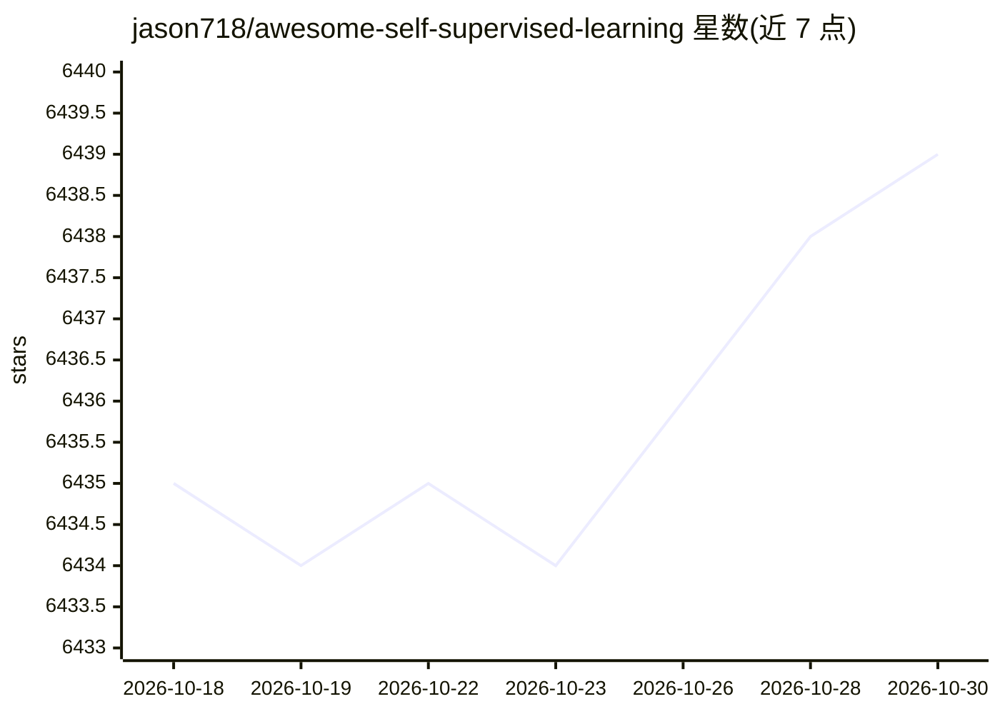

# jason718/awesome-self-supervised-learning

⭐ 6,439 · 推送 2026-02-24 · [GitHub](https://github.com/jason718/awesome-self-supervised-learning) · 个人维护

**自监督学习论文资源清单，覆盖理论、视觉等领域**

由个人维护的自监督学习论文策展清单（awesome list），条目按 Theory、Computer Vision（Survey、Image Representation Learning 等）及更多章节组织，收录 2015–2024 年论文，每条含 arXiv/OpenReview PDF 链接，部分附带官方代码仓库链接，理论部分收录至 ICML/ICLR/CVPR 等会议论文。面向机器学习研究者用于文献检索与追综，本身不提供代码或安装方式，仅以链接形式组织资源。

## 筛选速览

| 维度 | 判定 | 备注 |
|---|---|---|
| AI 角色 | `ai-knowledge` | 知识聚合/清单类 |
| 许可风险 | `none` | — |
| 部署形态 | `None` |  |
| 模型依赖 | — | README 未给出锁定关系 |
| 硬件要求 | — | 无带数字的原话,不猜 |
| 安装摩擦 | `low` | 无编译、无系统依赖或容器化 |
| 成熟度 | — | 结构信号不足 |

## 能力要点

- 按理论、计算机视觉等主题与年份组织论文条目
- 时间跨度 2015–2024，含多篇综述
- 部分条目附 PDF 与代码仓库双链接

## 适用场景

- 查找自监督学习方向的理论与视觉表征学习论文
- 通过综述条目快速入门自监督学习领域
- 定位经典方法的官方代码实现

## 场景标签

`精选清单` `科研工具` · 领域:学习与行业

## 证据(README 行号)

> L1: # Awesome Self-Supervised LearningAwesome
> L3: A curated list of awesome Self-Supervised Learning resources. Inspired by awesome-deep-vision, awesome-adversarial-m

## 星数曲线

2026-10-18 6,435 → 2026-10-30 6,439（+4）

---
*卡片 v1 · prompt 1.4 · 生成 2026-10-20 · 置信度 high · 依据 README sha `831343fb7d5c` · [字段定义](../../DATASET.md)*
