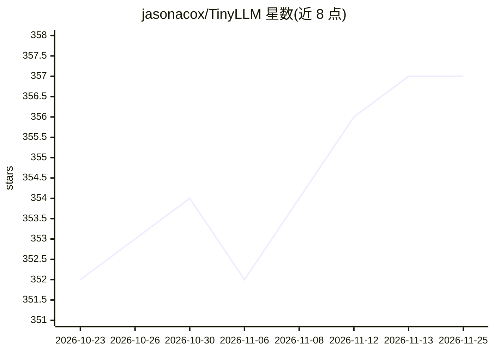

# jasonacox/TinyLLM

⭐ 357 · JavaScript · MIT · 推送 2026-10-25 · [GitHub](https://github.com/jasonacox/TinyLLM) · 个人维护

**在消费级硬件上搭建本地 LLM 推理服务与聊天界面**

面向想在本地小系统上运行大语言模型的用户，提供三条推理服务器部署路径（Ollama、vLLM、llama-cpp-python），三者均输出 OpenAI 兼容 API，并附带一个基于 FastAPI 的 ChatGPT 风格 Web 聊天应用，支持多会话、会话历史、URL/PDF 摘要、新闻/股票/天气命令及向量数据库 RAG 查询。README 给出硬件要求、模型推荐表（GGUF 量化与 vLLM 非量化两条线）及 Ollama 模型驻留调优方法；Quickstart 一节标注 TODO，需手动安装。

## 筛选速览

| 维度 | 判定 | 备注 |
|---|---|---|
| AI 角色 | `ai-ecosystem` | LLM/agent 周边工具 |
| 许可风险 | `permissive` | MIT |
| 部署形态 | `self-host` | docker 或自建部署 |
| 模型依赖 | local-ok | 支持本地模型 |
| 硬件要求 | — | 无带数字的原话,不猜 |
| 安装摩擦 | `low` | 无编译、无系统依赖或容器化 |
| 成熟度 | — | 结构信号不足 |

## 能力要点

- 支持经 Ollama、llama.cpp、vLLM 三种推理服务器构建本地 OpenAI API 服务
- FastAPI Web 聊天界面支持多会话、URL/PDF 摘要与 /news /stock /weather 命令
- 向量数据库 RAG 查询与外部来源接入
- 提供适配消费级 GPU 的量化模型推荐表与 Ollama 驻留/上下文调优说明

## 适用场景

- 在带消费级 GPU 的家用机器上自托管 LLM 聊天服务
- 需要 OpenAI 兼容 API 供本地工具接入的场景
- 通过网页对话总结网页、PDF 或查询新闻股票天气

## 场景标签

`聊天机器人` `RAG` `推理引擎` · 领域:对话与助手

## 证据(README 行号)

> L5: This project helps you build a small locally hosted LLM with a ChatGPT-like web interface using consumer grade hardw
> L12: * Builds a local OpenAI API web service via Ollama, llama.cpp or vLLM.
> L38: To run a local LLM, you will need an inference server for the model. This project recommends these options: vLLM, l

## 星数曲线

2026-10-23 352 → 2026-11-25 357（+5）

---
*卡片 v1 · prompt 1.4 · 生成 2026-11-25 · 置信度 high · 依据 README sha `f64f326f2933` · [字段定义](../../DATASET.md)*
