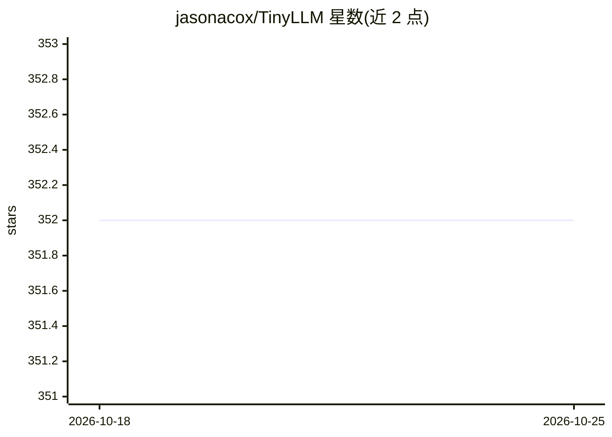

# jasonacox/TinyLLM

⭐ 353 · JavaScript · MIT · 推送 2026-10-25 · [GitHub](https://github.com/jasonacox/TinyLLM) · 个人维护

**在消费级硬件上搭建本地 LLM 与类 ChatGPT 聊天界面的指南项目**

TinyLLM 是一个帮助用户在消费级硬件上运行本地 LLM 的项目：给出基于 Ollama、vLLM、llama-cpp-python 三种推理服务器的安装运行步骤（均提供 OpenAI 兼容 API），并提供一个 Python FastAPI 编写的 Chatbot Web 应用，支持多会话、对话历史、URL/PDF 摘要、新闻/股票/天气命令与向量数据库 RAG 查询。附推荐模型清单（GGUF 与 vLLM 各一组）与 `llm` CLI 工具接入说明。快速启动脚本标注为 TODO，尚无一键部署。

## 筛选速览

| 维度 | 判定 | 备注 |
|---|---|---|
| AI 角色 | `ai-ecosystem` | LLM/agent 周边工具 |
| 许可风险 | `permissive` | MIT |
| 部署形态 | `self-host` | docker 或自建部署 |
| 模型依赖 | local-ok | 支持本地模型 |
| 硬件要求 | — | 无带数字的原话,不猜 |
| 安装摩擦 | `low` | 无编译、无系统依赖或容器化 |
| 成熟度 | — | 结构信号不足 |

## 能力要点

- 三种推理服务器方案：Ollama / vLLM / llama-cpp-python（均带 OpenAI 兼容 API）
- FastAPI Chatbot：多会话、URL/PDF 摘要、新闻/股票/天气命令
- 向量数据库 RAG 查询支持
- 分 GGUF 量化与 vLLM 两组的推荐模型清单（Mistral、Llama-3、Phi-4、Qwen 等）

## 适用场景

- 在自家 8GB 内存、消费级 GPU 的机器上跑一个本地 LLM 服务
- 通过网页聊天界面访问本地模型并做 RAG 问答
- 阅读 URL/PDF 并让本地模型生成摘要

## 场景标签

`聊天机器人` `RAG` `教程课程` · 领域:对话与助手

## 证据(README 行号)

> L5: This project helps you build a small locally hosted LLM with a ChatGPT-like web interface using consumer grade hardw
> L12: * Builds a local OpenAI API web service via Ollama, llama.cpp or vLLM.
> L38: To run a local LLM, you will need an inference server for the model. This project recommends these options: vLLM, l
> L86: The TinyLLM Chatbot is a simple web based python FastAPI app that allows you to chat with an LLM using the OpenAI A

## 星数曲线

2026-10-18 352 → 2026-10-25 352（+0）

---
*卡片 v1 · prompt 1.4 · 生成 2026-10-21 · 置信度 high · 依据 README sha `30f9e5c43933` · [字段定义](../../DATASET.md)*
