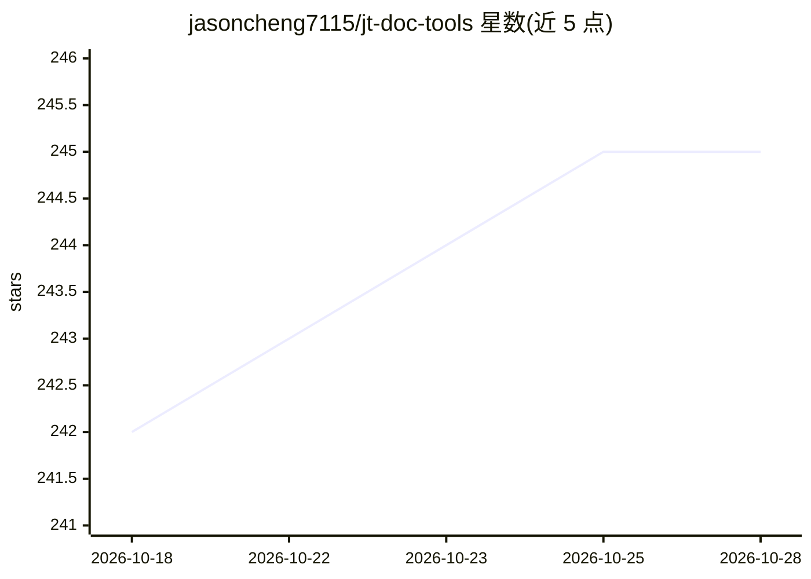

# jasoncheng7115/jt-doc-tools

⭐ 245 · Python · AGPL-3.0 · 推送 2026-10-25 · [GitHub](https://github.com/jasoncheng7115/jt-doc-tools) · [官网](https://jasoncheng7115.github.io/jt-doc-tools/) · 个人维护 · 中文 README

**自架开源的 PDF/Office 文件处理平台，含 52 种工具与可选 LLM 增强**

可自托管、单机或内网多人使用的文件处理平台，整合 52 个工具：填单用印、浮水印、页面编辑、格式转换（需 OxOffice/LibreOffice 引擎）、OCR（EasyOCR 默认、Tesseract 备援，可选外部 GPU 识别服务器）、去识别化、电子发票与统一编号处理、公文撰拟等。企业功能含本机/LDAP/AD 认证、SSO（OIDC+SAML）、RBAC、稽核记录、SIEM 转送、REST API 与 MCP。LLM 为可选增强（默认关闭），接 OpenAI-compatible 后端后 14 个工具增加翻译、摘要、OCR 校正等选项。安装占磁盘 12GB 起安装（含 PyTorch/EasyOCR）。

## 筛选速览

| 维度 | 判定 | 备注 |
|---|---|---|
| AI 角色 | `ai-enhanced` | 去掉 AI 部分产品仍成立 |
| 许可风险 | `viral` | AGPL-3.0 |
| 部署形态 | `desktop` | 安装包/桌面程序 |
| 模型依赖 | local-ok | 支持本地模型 |
| 硬件要求 | — | 无带数字的原话,不猜 |
| 安装摩擦 | `low` | 无编译、无系统依赖或容器化 |
| 成熟度 | — | 结构信号不足 |

## 能力要点

- 52 个文档工具：OCR、格式转换、去识别化、骑缝章、公文撰拟、电子发票处理等
- 企业功能：LDAP/AD 多域认证、SSO（OIDC+SAML）、RBAC、稽核记录、SIEM 转送、REST API、MCP
- LLM 可选增强：接 OpenAI-compatible 后端（Ollama/vLLM 等）后 14 个工具增加 text/vision 选项，默认关闭
- Linux/macOS 一行脚本安装，Windows 提供安装程序，支持 x86_64/arm64

## 适用场景

- 企业内网自建文档处理站，供多人处理 PDF 与 Office 文件
- 扫描件 OCR 转可搜索 PDF，可接外部 GPU 识别服务器加速
- 文件去识别化与送件前检核，处理敏感资料
- 台湾地区电子发票、统一编号查询与公文撰拟等本地化事务

## 场景标签

`OCR` `文档解析` · 领域:知识与检索

## 证据(README 行号)

> L28: > 整合式 PDF / Office 文件處理平台，52 個工具整合解決：**填單用印**、**浮水印**、**多頁合併 / 拆分 / 旋轉 / 整理**、**轉檔**、**掃描拼合**、**去識別化**、**字數統計**、**註
> L207: ## LLM AI 加值（選用，預設關閉）
> L209: 接 OpenAI-compatible 後端（本機 Ollama、LiteLLM 等 LLM 閘道、vLLM、LM Studio、DGX Spark）後，**14 個工具**自動多出聰明選項：

## 星数曲线

2026-10-18 242 → 2026-10-28 245（+3）

---
*卡片 v1 · prompt 1.4 · 生成 2026-10-22 · 置信度 mid · 依据 README sha `8f5134f1bd0a` · [字段定义](../../DATASET.md)*
