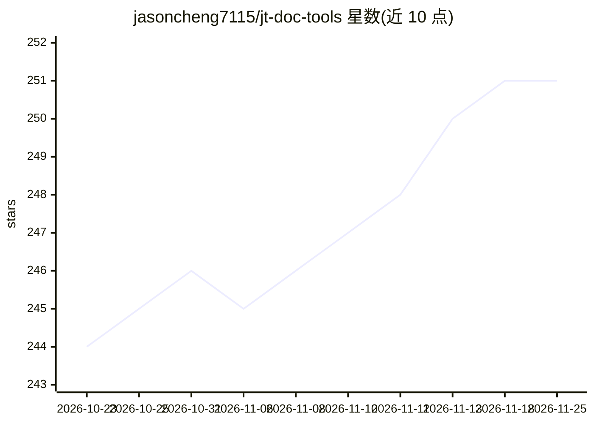

# jasoncheng7115/jt-doc-tools

⭐ 251 · HTML · AGPL-3.0 · 推送 2026-11-23 · [GitHub](https://github.com/jasoncheng7115/jt-doc-tools) · [官网](https://jasoncheng7115.github.io/jt-doc-tools/) · 个人维护 · 中文 README

**自架開源 PDF/Office 文件處理平台，54 個工具整合**

自架式文件處理平台，整合 54 個工具：填單用印、浮水印、合併/拆分、轉檔、OCR、去識別化、差異比對、逐句翻譯、電子發票處理、公文撰擬等。企業功能含 LDAP/AD 認證、SSO（OIDC/SAML）、RBAC、稽核記錄、SIEM 轉送、REST API 與 MCP。部分工具標示需 OxOffice/LibreOffice 引擎；LLM 用於公文撰擬、摘要、OCR 校正等選項。透過 curl 安裝腳本或 Windows 安裝程式部署，Linux/macOS/Windows 可單機或內網架站。

## 筛选速览

| 维度 | 判定 | 备注 |
|---|---|---|
| AI 角色 | `ai-enhanced` | 去掉 AI 部分产品仍成立 |
| 许可风险 | `viral` | AGPL-3.0 |
| 部署形态 | `desktop` | 安装包/桌面程序 |
| 模型依赖 | — | README 未给出锁定关系 |
| 硬件要求 | — | 无带数字的原话,不猜 |
| 安装摩擦 | `low` | 无编译、无系统依赖或容器化 |
| 成熟度 | — | 结构信号不足 |

## 能力要点

- 54 個 PDF/Office 工具整合於單一自架平台
- 企業功能：LDAP/AD 認證、SSO、RBAC、稽核記錄、SIEM 轉送
- OCR 雙引擎（EasyOCR 預設/Tesseract），支援外部 GPU 識別伺服器部署
- 用印申請核准流程與 MCP 介面（供 Claude Code 等呼叫工具）

## 适用场景

- 企業內部自架文件處理平台，資料不上雲
- 公文/標案文件的合併、用印、轉檔與送件前檢核
- 掃描文件 OCR 與發票、名片、乘車證明批次整理報帳

## 场景标签

`OCR` `文档解析` · 领域:知识与检索

## 证据(README 行号)

> L28: > 整合式 PDF / Office 文件處理平台，54 個工具整合解決：**填單用印**、**浮水印**、**多頁合併 / 拆分 / 旋轉 / 整理**、**轉檔**、**掃描拼合**、**去識別化**、**字數統計**、**註
> L30: > 企業功能：**本機 / LDAP / AD 多領域認證**、**SSO 單一登入**(OIDC + SAML，可接 M365 / Google / Keycloak)、**RBAC 角色權限**、**稽核記錄**、**SIEM
> L123: - **名片辨識**（Beta）— 名片照片或掃描檔一次匯入（手機可以連拍），一張照片放好幾張名片也能自動切卡（可拖四角修正），辨識姓名 / 公司 / 職稱 / 電話 / 分機 / Email / 統編 / 地址（繁中＋英文，也

## 星数曲线

2026-10-23 244 → 2026-11-25 251（+7）

---
*卡片 v1 · prompt 1.4 · 生成 2026-11-25 · 置信度 mid · 依据 README sha `e3b4858a41d3` · [字段定义](../../DATASET.md)*
