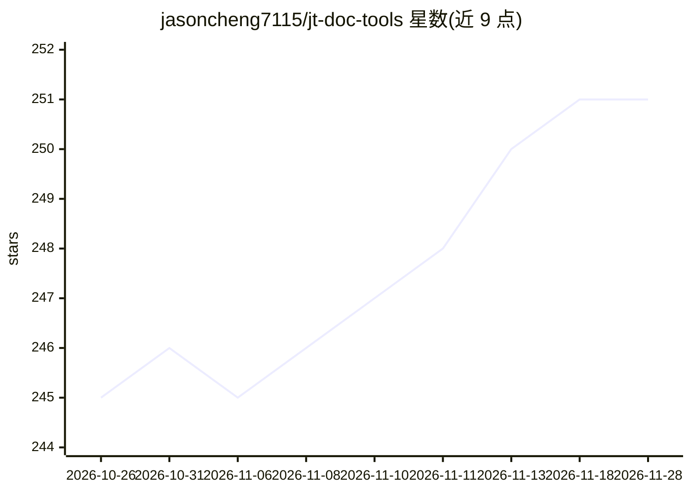

# jasoncheng7115/jt-doc-tools

⭐ 251 · HTML · AGPL-3.0 · 推送 2026-11-26 · [GitHub](https://github.com/jasoncheng7115/jt-doc-tools) · [官网](https://jasoncheng7115.github.io/jt-doc-tools/) · 个人维护 · 中文 README

**自架式 PDF/Office 文件处理平台，54 个工具整合**

整合式 PDF / Office 文件处理平台，提供表单填写用印、水印、合并拆分、转档、扫描拼合、去识别化、OCR 文字辨识、电子发票处理等 54 个工具，以浏览器访问的 Web 服务形式运行。面向需要集中处理公文与企业文件的用户，提供本机/LDAP/AD 认证、SSO、RBAC、审计记录、SIEM 转送与 REST API/MCP 接口。部分工具依赖 OxOffice/LibreOffice 引擎；OCR 默认 EasyOCR、备援 Tesseract，可选 LLM 校正；支持 Linux/macOS/Windows 单机或内网架站，数据不上云。

## 筛选速览

| 维度 | 判定 | 备注 |
|---|---|---|
| AI 角色 | `ai-enhanced` | 去掉 AI 部分产品仍成立 |
| 许可风险 | `viral` | AGPL-3.0 |
| 部署形态 | `desktop` | 安装包/桌面程序 |
| 模型依赖 | — | README 未给出锁定关系 |
| 硬件要求 | — | 无带数字的原话,不猜 |
| 安装摩擦 | `low` | 无编译、无系统依赖或容器化 |
| 成熟度 | — | 结构信号不足 |

## 能力要点

- 54 个工具覆盖 PDF 编辑、转档、去识别化、加密、发票与清单处理
- 企业功能：多领域认证、SSO (OIDC/SAML)、RBAC、审计记录、SIEM 转送
- OCR 双引擎（EasyOCR 预设/Tesseract 备援），支持外部 GPU 识别服务器部署
- 用印申请审批流程、加密纸本备份（Shamir 分片）、背景作业与完成通知

## 适用场景

- 企业内网自建文件处理站，数据不出内网
- 公文撰拟、逐句翻译、会议逐字稿与摘要整理
- 台湾电子发票与乘车证明批量整理报帐
- 扫描件 OCR 转可搜索 PDF 并去识别化

## 场景标签

`OCR` `文档解析` · 领域:知识与检索

## 证据(README 行号)

> L28: > 整合式 PDF / Office 文件處理平台，54 個工具整合解決：**填單用印**、**浮水印**、**多頁合併 / 拆分 / 旋轉 / 整理**、**轉檔**、**掃描拼合**、**去識別化**、**字數統計**、**註
> L30: > 企業功能：**本機 / LDAP / AD 多領域認證**、**SSO 單一登入**(OIDC + SAML，可接 M365 / Google / Keycloak)、**RBAC 角色權限**、**稽核記錄**、**SIEM
> L119: - **OCR 文字辨識** — 掃描 PDF / 圖片跑 OCR 後變可搜尋、可滑鼠選取複製（同 macOS 預覽程式 Live Text 概念）；雙引擎（**EasyOCR** 預設，中日韓辨識準確度高；**Tesserac

## 星数曲线

2026-10-26 245 → 2026-11-28 251（+6）

---
*卡片 v1 · prompt 1.4 · 生成 2026-11-27 · 置信度 high · 依据 README sha `e2134a5948b8` · [字段定义](../../DATASET.md)*
