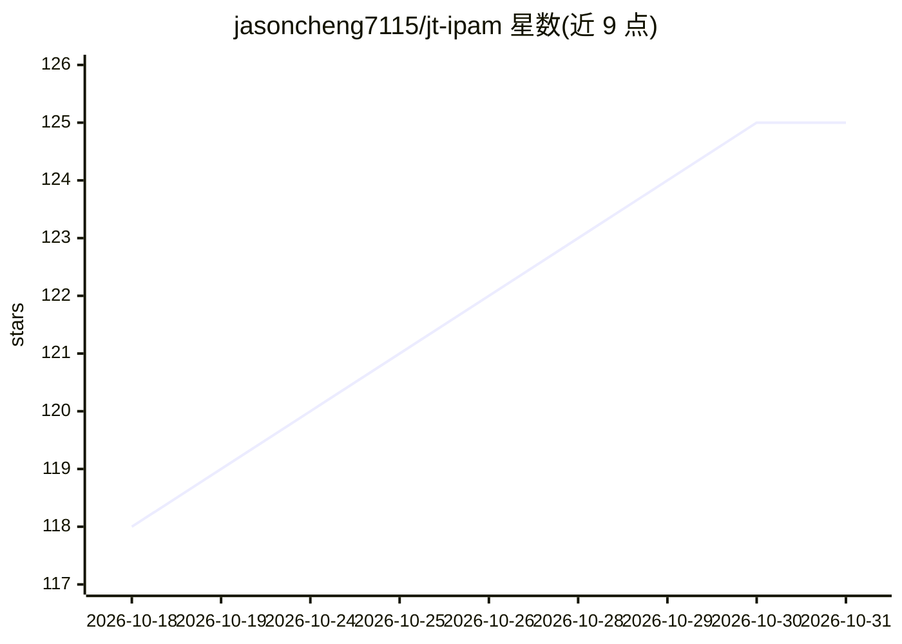

# jasoncheng7115/jt-ipam

⭐ 125 · Python · AGPL-3.0 · 推送 2026-10-26 · [GitHub](https://github.com/jasoncheng7115/jt-ipam) · [官网](https://jasoncheng7115.github.io/jt-ipam/) · 组织维护 · 中文 README

**自托管 IPAM：操作流接近 phpIPAM，深度集成多种 DNS/网络/虚拟化平台**

独立开发的自托管 IPAM 系统，基于 Python/FastAPI/Vue/PostgreSQL，操作流程面向 phpIPAM 使用者。核心是 IP 地址管理，并与 PowerDNS/BIND、LibreNMS、OPNsense/pfSense、FortiGate、Palo Alto、Check Point、MikroTik、Proxmox VE、VMware、Hyper-V、Wazuh、Zabbix、多种 DHCP 服务器等集成。内置扫描代理、IP 变更评估、远程控制台、审批流与证书分发。AI 部分：本地 LLM 驱动的自然语言查询与语义搜索、MCP server、防火墙规则变更哨兵与未授权 IP 分诊卡。AGPL-3.0 许可。

## 筛选速览

| 维度 | 判定 | 备注 |
|---|---|---|
| AI 角色 | `ai-enhanced` | 去掉 AI 部分产品仍成立 |
| 许可风险 | `viral` | AGPL-3.0 |
| 部署形态 | `self-host` | docker 或自建部署 |
| 模型依赖 | — | README 未给出锁定关系 |
| 硬件要求 | — | 无带数字的原话,不猜 |
| 安装摩擦 | `low` | 无编译、无系统依赖或容器化 |
| 成熟度 | `idea` | |

## 能力要点

- 与 20+ 种 DNS/DHCP/防火墙/监控/虚拟化系统的集成（多为只读）
- 本地 LLM 自然语言查询、语义搜索与 MCP server（stdio 与 Streamable HTTP）
- IP 变更评估：跨集成列出引用与受影响服务，按阻断/审查/需变更分级
- 扫描代理支持大子网（如 /8）注册扫描与远程控制台（SSH/RDP/VNC/BMC）

## 适用场景

- 企业网络团队统一管理 IP 地址、DNS/DHCP 与防火墙对象
- 重新编址或设备下线前评估全网引用与影响
- 通过对话查询 IP 历史与取证信息（谁在用这个 IP）
- 与 LibreNMS/Zabbix/Wazuh 联动做设备纳管与监控覆盖核查

## 场景标签

 · 领域:网络运维/IP 地址管理

## 证据(README 行号)

> L32: - **Local AI**: natural-language queries and semantic search over LLM Server (self-hosted by default, so data never
> L38: Also built in: a **browser-based remote console** offering an SSH terminal, an **SFTP file browser** (upload/downlo

## 星数曲线

2026-10-18 118 → 2026-10-31 125（+7）

---
*卡片 v1 · prompt 1.4 · 生成 2026-10-23 · 置信度 high · 依据 README sha `c07249e47056` · [字段定义](../../DATASET.md)*
