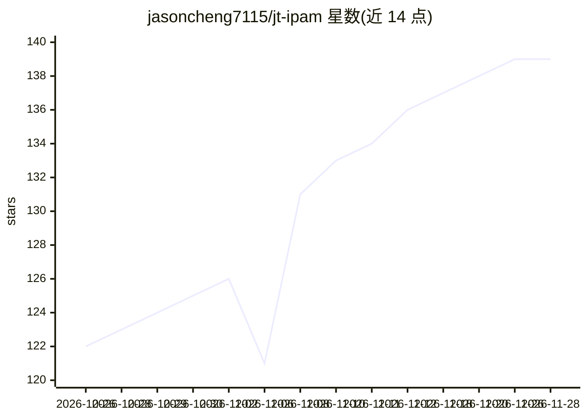

# jasoncheng7115/jt-ipam

⭐ 139 · Python · AGPL-3.0 · 推送 2026-11-25 · [GitHub](https://github.com/jasoncheng7115/jt-ipam) · [官网](https://jasoncheng7115.github.io/jt-ipam/) · 组织维护 · 中文 README

**自托管 IPAM：为网络团队管理 IP 并集成 DNS/监控/虚拟化**

Python/FastAPI + Vue + PostgreSQL 构建的自托管 IP 地址管理工具，操作流程面向 phpIPAM 用户。深度集成 DNS 服务器（PowerDNS、BIND 9、Windows DNS 等只读）、DHCP、LibreNMS/Zabbix/Checkmk 监控、Proxmox/ESXi/Hyper-V/OpenStack 虚拟化、Wazuh、防火墙设备与 Kubernetes。本地 LLM 提供自然语言查询与语义搜索，另提供 MCP server 供外部 LLM 客户端调用；含 IP 变更评估与扫描 agent 体系。许可为 AGPL-3.0。

## 筛选速览

| 维度 | 判定 | 备注 |
|---|---|---|
| AI 角色 | `ai-enhanced` | 去掉 AI 部分产品仍成立 |
| 许可风险 | `viral` | AGPL-3.0 |
| 部署形态 | `self-host` | docker 或自建部署 |
| 模型依赖 | local-ok | 支持本地模型 |
| 硬件要求 | — | 无带数字的原话,不猜 |
| 安装摩擦 | `low` | 无编译、无系统依赖或容器化 |
| 成熟度 | — | 结构信号不足 |

## 能力要点

- 深度集成 DNS/DHCP/监控/虚拟化/防火墙等数十类网络基础设施
- 本地 LLM 自然语言查询与语义搜索，数据不出主机
- 提供 MCP server（stdio 与 Streamable HTTP），外部 LLM 客户端可驱动 IPAM
- 扫描 agent 支持大子网（如 /8）后台探索与自更新

## 适用场景

- 为中小网络团队自托管管理 IP 地址与子网
- 在改地址前评估 DNS/DHCP/防火墙/监控中的引用点
- 通过自然语言查询 IPAM 数据并在聊天中做 IP 取证

## 场景标签

 · 领域:网络运维/基础设施管理

## 证据(README 行号)

> L14: > A self-hosted, integration-focused IPAM, independently developed with an operation flow familiar to phpIPAM users
> L34: - **Local AI**: natural-language queries and semantic search over LLM Server (self-hosted by default, so data never

## 星数曲线

2026-10-26 122 → 2026-11-28 139（+17）

---
*卡片 v1 · prompt 1.4 · 生成 2026-11-27 · 置信度 high · 依据 README sha `ca564a8f3180` · [字段定义](../../DATASET.md)*
