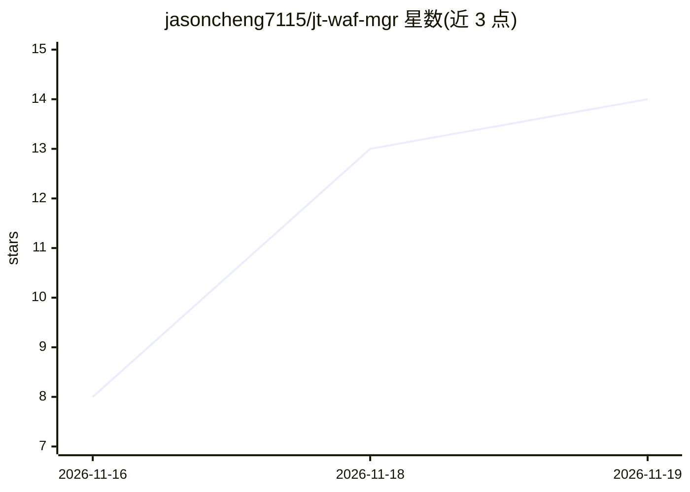

# jasoncheng7115/jt-waf-mgr

⭐ 14 · Python · AGPL-3.0 · 推送 2026-11-18 · [GitHub](https://github.com/jasoncheng7115/jt-waf-mgr) · [官网](https://jasoncheng7115.github.io/jt-waf-mgr/) · 组织维护 · 中文 README

**给 nginx+ModSecurity WAF 的自托管管理器：审计、变更审批与 LLM 分诊**

自托管的 Web 管理器，运行在 nginx 宿主机旁，读取 libmodsecurity v3 的 JSON 审计日志并提供可视化事件浏览。核心机制是变更工作流：模板生成规则→静态检查（正则、ReDoS）→访问日志证据→一次性 nginx 沙箱回归→人工审批→根程序测试重载，失败自动恢复，支持版本回滚。审计日志为哈希链追加式，对接 syslog，提供 ISO 27001 等合规视图。可选接入自托管 OpenAI 兼容 LLM 做事件分诊与威胁情报，模型只提建议，放宽操作始终需人工批准。

## 筛选速览

| 维度 | 判定 | 备注 |
|---|---|---|
| AI 角色 | `ai-enhanced` | 去掉 AI 部分产品仍成立 |
| 许可风险 | `viral` | AGPL-3.0 |
| 部署形态 | `None` |  |
| 模型依赖 | local-ok | 支持本地模型 |
| 硬件要求 | — | 无带数字的原话,不猜 |
| 安装摩擦 | `low` | 无编译、无系统依赖或容器化 |
| 成熟度 | — | 结构信号不足 |

## 能力要点

- 规则变更的证据检查→沙箱回归→审批→一键回滚工作流
- 哈希链追加式审计日志，锚定于数据库外与 syslog
- 自托管 LLM 事件分诊：程序而非模型做决定，放宽需人工与一次性码
- 二级 LLM 威胁情报结合 CISA/KEV 目录生成虚拟补丁

## 适用场景

- 集中查看与分诊生产 WAF 的拦截与误报事件
- 带审批与回滚的团队协作式规则调优
- 用本地 LLM 辅助分析攻击与误报，但不放权给模型
- 对接 Teams/Telegram/Slack 等渠道的 WAF 告警通知

## 场景标签

`网络安全` · 领域:学习与行业

## 证据(README 行号)

> L15: > A self-hosted web manager for **nginx + libmodsecurity v3 + OWASP CRS 4**: read what the WAF did, tune it through
> L35: - **Let a model help, never decide alone**: a scheduled analysis with your own OpenAI-compatible LLM server propose

## 星数曲线

2026-11-16 8 → 2026-11-19 14（+6）

---
*卡片 v1 · prompt 1.4 · 生成 2026-11-18 · 置信度 high · 依据 README sha `a07052f9e56c` · [字段定义](../../DATASET.md)*
