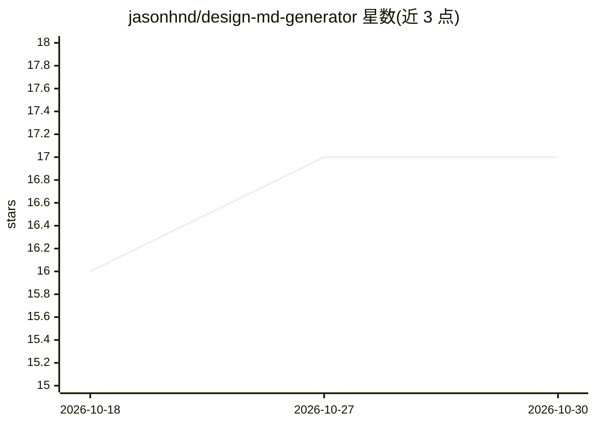

# jasonhnd/design-md-generator

⭐ 17 · TypeScript · MIT · 推送 2026-04-19 · [GitHub](https://github.com/jasonhnd/design-md-generator) · 个人维护

**从任意网站 URL 提取设计令牌并生成 DESIGN.md 的工具**

基于 Playwright 的设计系统提取工具：爬取网站计算样式、CSS 变量、字体与阴影，经 OKLCH delta-E 聚类生成设计令牌，按 4 层时间稳定性分类，最终由 10 个并行子代理写出 17 节的 DESIGN.md v2 文档，供 AI UI 编码代理（Claude Code、Cursor、Copilot 等）读取以复刻目标站点视觉。附带像素级保真校验、验证脚本与可视化报告，MIT 许可。输出声明非官方设计系统文档，商用字体需另行授权。

## 筛选速览

| 维度 | 判定 | 备注 |
|---|---|---|
| AI 角色 | `ai-ecosystem` | LLM/agent 周边工具 |
| 许可风险 | `permissive` | MIT |
| 部署形态 | `library` | 以包/库形式分发 |
| 模型依赖 | — | README 未给出锁定关系 |
| 硬件要求 | — | 无带数字的原话,不猜 |
| 安装摩擦 | `low` | 无编译、无系统依赖或容器化 |
| 成熟度 | — | 结构信号不足 |

## 能力要点

- Playwright 抓取计算样式，OKLCH delta-E 聚类生成令牌
- 4 层稳定性分类（基础设施/系统/营销/内容）
- 17 节 DESIGN.md v2 格式，含暗色模式、无障碍、状态矩阵
- 像素级保真校验（ΔE<12）与验证脚本、50 个测试

## 适用场景

- 让 AI 编码代理按目标网站风格生成 UI
- 提取自有产品的设计令牌形成统一参考文档
- 分析任意 URL 的调色板、字体层级与组件样式

## 场景标签

`网页抓取` · 领域:效率与自动化

## 证据(README 行号)

> L9: Extract design systems from any website. Drop a `DESIGN.md` into your project, tell your AI agent "build me a page t
> L68: Clone this repo into your project. Your AI agent reads the matching instructions file:

## 星数曲线

2026-10-18 16 → 2026-10-30 17（+1）

---
*卡片 v1 · prompt 1.4 · 生成 2026-10-29 · 置信度 high · 依据 README sha `4cd9ccf12191` · [字段定义](../../DATASET.md)*
