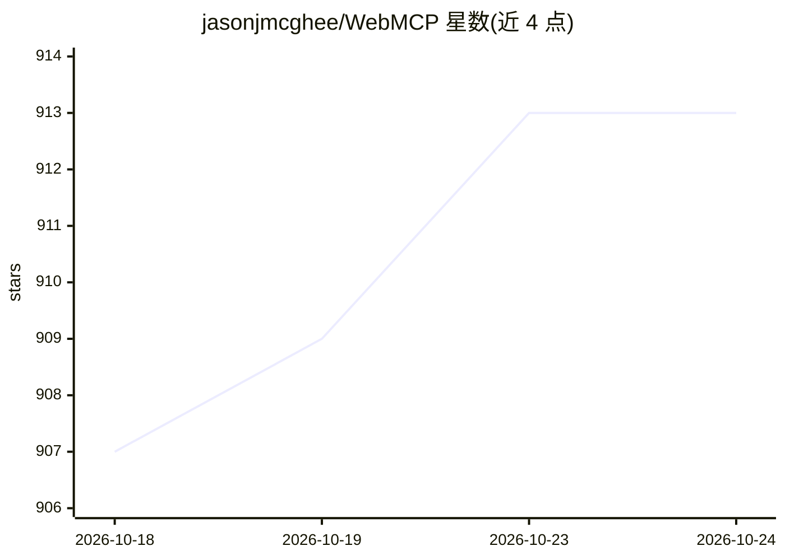

# jasonjmcghee/WebMCP

⭐ 913 · JavaScript · MIT · 推送 2026-02-15 · [GitHub](https://github.com/jasonjmcghee/WebMCP) · [官网](https://webmcp.dev/) · 个人维护

**让网站成为 MCP 服务器向本地 LLM 暴露工具的早期提案实现**

由个人开发者提出的 WebMCP 早期提案与实现：通过网页嵌入 webmcp.js 组件，使网站能向客户端 LLM 暴露工具、资源与 prompts；本地运行仅监听 localhost 的 websocket 服务器作为 MCP 客户端与网页之间的桥接，经注册 token 认证，多网站可同时连接且工具按域名加前缀。安装通过 npx 一条命令配置 claude/cursor/cline/windsurf 等 MCP 客户端。README 顶部声明本实现不兼容 W3C 规范，工作已转移至 webmachinelearning/webmcp 仓库，并自述处于早期阶段、安全加固待完善。

## 筛选速览

| 维度 | 判定 | 备注 |
|---|---|---|
| AI 角色 | `ai-ecosystem` | LLM/agent 周边工具 |
| 许可风险 | `permissive` | MIT |
| 部署形态 | `self-host` | docker 或自建部署 |
| 模型依赖 | — | README 未给出锁定关系 |
| 硬件要求 | — | 无带数字的原话,不猜 |
| 安装摩擦 | `low` | 无编译、无系统依赖或容器化 |
| 成熟度 | `idea` | |

## 能力要点

- 网站嵌入 webmcp.js 即可作为 MCP 服务器暴露工具/资源/prompts
- localhost websocket 桥接 MCP 客户端与网页，token 一次性注册认证
- npx 一条命令自动配置 claude/cursor/cline/windsurf 等客户端
- 提供 Dockerfile 与 docker-compose.yml 运行 websocket 服务器

## 适用场景

- 网站作者向访问者的本地 LLM 提供站点工具
- 用任意 MCP 客户端同时连接多个网站并按域名区分工具
- 了解 WebMCP 概念的早期参考实现

## 场景标签

`Agent 框架` · 领域:Agent 开发

## 证据(README 行号)

> L19: WebMCP allows websites to share tools, resources, prompts, etc. to LLMs. In other words, WebMCP allows a website to
> L23: It comes in the form of a widget that a website owner can put on their site and expose tools to give client-side LL

## 星数曲线

2026-10-18 907 → 2026-10-24 913（+6）

---
*卡片 v1 · prompt 1.4 · 生成 2026-10-21 · 置信度 high · 依据 README sha `6fac12496f1a` · [字段定义](../../DATASET.md)*
