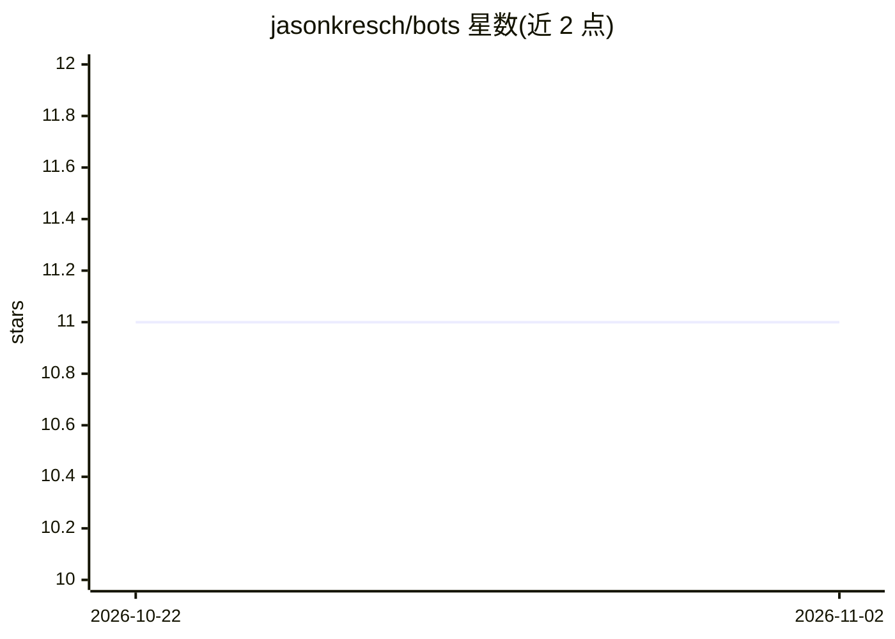

# jasonkresch/bots

⭐ 11 · Java · MIT · 推送 2026-09-24 · [GitHub](https://github.com/jasonkresch/bots) · 个人维护

**人工生命模拟实验：神经网格斗士经遗传编程进化出觅食行为**

基于 Java 的人工生命（Artificial Life）模拟程序：在一个 Bot Arena 中运行大量带神经网络大脑（22 输入神经元、可配置隐藏层、4 输出运动神经元）的 bot，通过每代选择存活个体、繁殖与变异，进化出觅食绿球、避开红球等行为。提供图形界面配置代大小、变异率、环境参数等，支持自动存档与断点续跑，训练中可实时改变参数观察适应过程。需 JDK 编译后用脚本运行，支持 Linux/macOS/Windows 命令行。

## 筛选速览

| 维度 | 判定 | 备注 |
|---|---|---|
| AI 角色 | `ai-native` | 本体是模型或模型工具 |
| 许可风险 | `permissive` | MIT |
| 部署形态 | `desktop` | 安装包/桌面程序 |
| 模型依赖 | — | README 未给出锁定关系 |
| 硬件要求 | — | 无带数字的原话,不猜 |
| 安装摩擦 | `medium` | 含编译或系统依赖之一 |
| 成熟度 | — | 结构信号不足 |

## 能力要点

- 遗传算法驱动的神经网络 bot 进化（选择/繁殖/变异）
- 可配置的进化、bot、环境与显示四类模拟参数
- Autosave 自动存档与 Load State 断点续跑
- 训练中可实时修改环境参数并观察行为适应

## 适用场景

- 运行进化模拟实验，观察神经网络 bot 涌现的行为策略
- 调整环境参数（红绿球比例、墙壁、速度）研究不同适应结果
- 长时间训练获得高度优化的 bot 行为

## 场景标签

 · 领域:人工智能模拟/进化计算

## 证据(README 行号)

> L2: An experiment in artificial life, artificial neural nets, artificial sentience, simulated evolution, simulated consc
> L103: * **Bot Brain Size** - The number of neurons in the hidden layer of the Bot's neural network brain, which sit betw

## 星数曲线

2026-10-22 11 → 2026-11-02 11（+0）

---
*卡片 v1 · prompt 1.4 · 生成 2026-11-02 · 置信度 high · 依据 README sha `c461a495c8db` · [字段定义](../../DATASET.md)*
