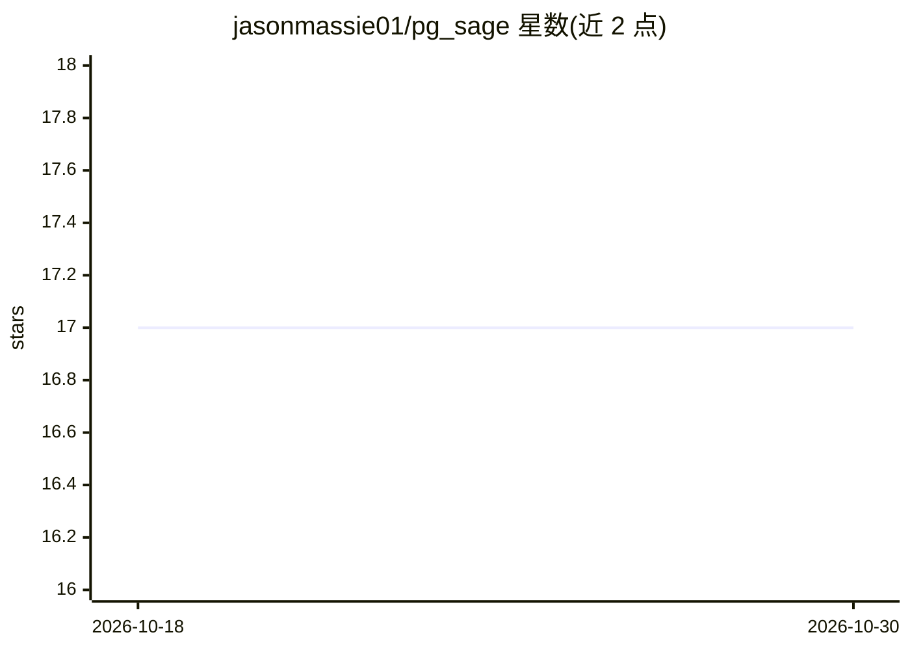

# jasonmassie01/pg_sage

⭐ 17 · Go · AGPL-3.0 · 推送 2026-10-24 · [GitHub](https://github.com/jasonmassie01/pg_sage) · 个人维护

**PostgreSQL 14-18 的 Agent 化 DBA：监控、分析并执行优化动作**

以单个 Go 二进制形式运行在 PostgreSQL 实例旁的 DBA 边车：通过标准线协议连接，从目录视图和 pg_stat_statements 采集性能数据，将问题投影为 DBA Cases，用 LLM 做深度分析（未配置 LLM 端点前仅运行确定性规则）。信任分级执行器按 Observation→Advisory→Autonomous 提出或执行带护栏、审批门与回滚元数据的类型化动作，HIGH 风险动作必须审批；另有影子模式报告。支持 Lakebase、Cloud SQL、AlloyDB、Aurora、RDS、Neon、Supabase 及自管 Postgres。内嵌 React SPA 仪表盘、REST API 与 Prometheus 指标。

## 筛选速览

| 维度 | 判定 | 备注 |
|---|---|---|
| AI 角色 | `ai-enhanced` | 去掉 AI 部分产品仍成立 |
| 许可风险 | `viral` | AGPL-3.0 |
| 部署形态 | `None` |  |
| 模型依赖 | — | README 未给出锁定关系 |
| 硬件要求 | — | 无带数字的原话,不猜 |
| 安装摩擦 | `medium` | 含编译或系统依赖之一 |
| 成熟度 | — | 结构信号不足 |

## 能力要点

- 20+ 确定性规则检查（索引/慢查询/vacuum/复制延迟/安全审计等）
- 信任分级执行器：类型化动作带风险层级、护栏、回滚与验证状态，HIGH 风险需审批
- LLM 索引优化建议经 8 项检查 + HypoPG 成本估算验证，置信度打分
- Fleet 模式：单二进制监控 N 个数据库，按库设信任级别与 token 预算

## 适用场景

- 让 DBA 以 Cases 队列方式处理慢查询、锁、vacuum 膨胀等运维问题
- 在开启自主执行前用影子模式预览 AI 会执行的动作
- 跨 Cloud SQL/AlloyDB/RDS/Aurora/Neon/Supabase 等多种托管 Postgres 做舰队监控
- 通过 MCP 让 Claude Code/Cursor 连接处理 source-fix 数据包

## 场景标签

 · 领域:数据库运维/可观测性

## 证据(README 行号)

> L13: `pg_stat_statements`, projects issues into DBA **Cases**, and uses an LLM for
> L15: endpoint and API key (until then pg_sage runs its deterministic rules). A trust-ramped executor proposes or applies
> L64: |**Sage SRE Investigations**|Each lock, connection or WAL incident and plan regression gets a read-only, bounded in

## 星数曲线

2026-10-18 17 → 2026-10-30 17（+0）

---
*卡片 v1 · prompt 1.4 · 生成 2026-10-29 · 置信度 high · 依据 README sha `f1b855ddcc1f` · [字段定义](../../DATASET.md)*
