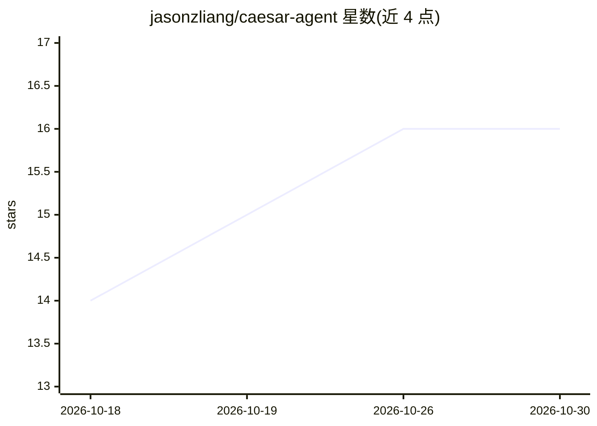

# jasonzliang/caesar-agent

⭐ 16 · Python · Apache-2.0 · 推送 2026-10-28 · [GitHub](https://github.com/jasonzliang/caesar-agent) · [官网](https://jasonzliang.github.io/caesar-agent/) · 个人维护

**自主网络研究 agent：图探索+对抗式综合生成研究答案**

Caesar 是一个自主 AI 研究 agent：以 Perceive–Think–Act 循环递归遍历网页，在探索过程中构建持久知识图，再经多轮对抗式自我修正与合并生成带引用的研究成果（artifact）。面向开放式、跨学科研究场景，如假说生成、文献综合、arXiv 引文图遍历与竞争格局分析。基于 Rome FSM 框架实现，通过托管 LLM API（OpenAI/Anthropic/Google）运行，无需 GPU，本地 ChromaDB 作向量库；提供 PyPI 安装、命令行与 FastAPI+Next.js 网页界面。README 报告了 LLM-as-a-Judge 与人工评测的基准数字，并自称研究原型（research prototype），单次运行典型耗时 10 分钟至 1.5 小时、费用约 $0.80–$10。

## 筛选速览

| 维度 | 判定 | 备注 |
|---|---|---|
| AI 角色 | `ai-native` | 本体是模型或模型工具 |
| 许可风险 | `permissive` | Apache-2.0 |
| 部署形态 | `library` | 以包/库形式分发 |
| 模型依赖 | locked-api |  |
| 硬件要求 | — | 无带数字的原话,不猜 |
| 安装摩擦 | `low` | 无编译、无系统依赖或容器化 |
| 成熟度 | `idea` | |

## 能力要点

- 探索期构建持久知识图，支持深度优先扩展、回溯与定向搜索的策略切换
- 对抗式多草稿综合：对自身草稿提出正交质询后递归生成并合并
- 输出可复现：每草稿存档、图保存为 JSON 检查点、运行日志可导出
- 支持 arXiv 引文图遍历模式（基于 Semantic Scholar）

## 适用场景

- 生成跨领域假说与新颖方案构思
- 对一组论文做图结构化的文献综合，发现张力与空白
- 深度梳理某个技术或市场格局
- 无需 GPU，用自己的 API key 在笔记本上跑深度研究

## 场景标签

`科研工具` `知识图谱` `RAG` · 领域:知识与检索

## 证据(README 行号)

> L19: **Caesar** is an autonomous AI research agent that navigates the web, reasons
> L20: over a dynamic knowledge graph, and synthesizes novel, grounded answers. In

## 星数曲线

2026-10-18 14 → 2026-10-30 16（+2）

---
*卡片 v1 · prompt 1.4 · 生成 2026-10-30 · 置信度 high · 依据 README sha `691a99d18d91` · [字段定义](../../DATASET.md)*
