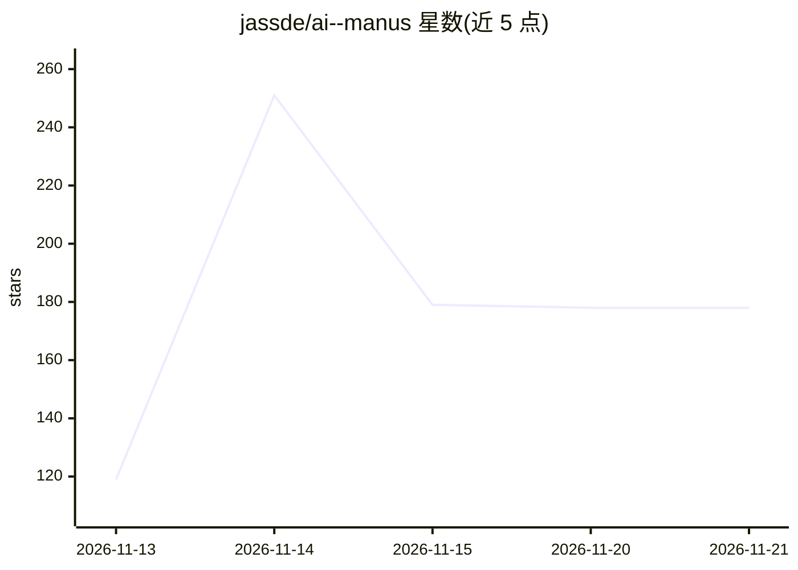

# jassde/ai--manus

⭐ 178 · Apache-2.0 · 推送 2026-11-15 · [GitHub](https://github.com/jassde/ai--manus) · 个人维护

**面向个人用户的自主 AI Agent：自动执行代码与浏览器操作**

自称 Manus 的自主 AI Agent 系统，在沙箱环境中运行工具与操作：自主编写并执行脚本、控制浏览器（导航网页、填写表单、采集信息）、执行多步骤任务，定位为家庭、学习与轻量办公场景的个人助手，而非企业平台。README 描述了配置、测试与定制任务类型的使用步骤，并列出硬件兼容表（最低 4 GB 内存、双核 CPU）。但全文为宣传式介绍，未提供任何具体安装命令、代码仓库结构或模型接入方式，实际可用性无法从 README 验证。

## 筛选速览

| 维度 | 判定 | 备注 |
|---|---|---|
| AI 角色 | `ai-native` | 本体是模型或模型工具 |
| 许可风险 | `permissive` | Apache-2.0 |
| 部署形态 | `None` |  |
| 模型依赖 | — | README 未给出锁定关系 |
| 硬件要求 | — | 无带数字的原话,不猜 |
| 安装摩擦 | `low` | 无编译、无系统依赖或容器化 |
| 成熟度 | — | 结构信号不足 |

## 能力要点

- 自主执行代码与脚本
- 浏览器控制：导航、填表、信息采集
- 多步骤任务自动化，代码与浏览器操作可衔接

## 适用场景

- 让代理代为完成重复性的网页查询与表单填写
- 学习与研究中整理资料、运行小脚本
- 轻量办公中跨多页面收集信息并汇总

## 场景标签

`AI 助手` `编码 Agent` `浏览器自动化` · 领域:效率与自动化

## 证据(README 行号)

> L18: Manus is an autonomous AI agent designed to run code and control a browser on your behalf. Instead of acting like a
> L22: Manus is not a heavy studio suite or a complex enterprise platform. It is a focused helper built for home, study, a

## 星数曲线

2026-11-13 119 → 2026-11-21 178（+59）

---
*卡片 v1 · prompt 1.4 · 生成 2026-11-17 · 置信度 mid · 依据 README sha `0f78ee3a5dd2` · [字段定义](../../DATASET.md)*
