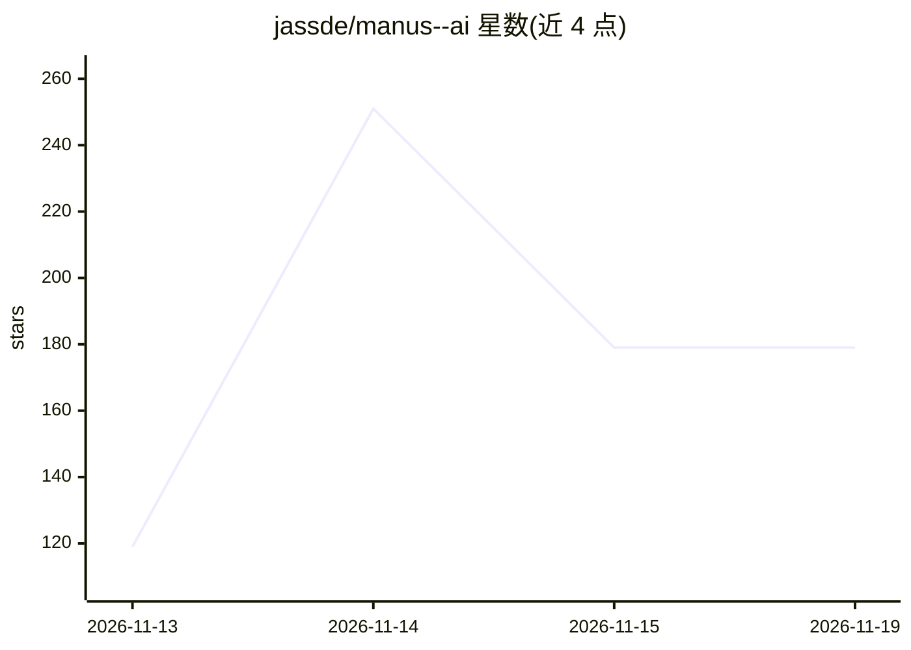

# jassde/manus--ai

⭐ 179 · Apache-2.0 · 推送 2026-11-15 · [GitHub](https://github.com/jassde/manus--ai) · 个人维护

**面向个人用户的自主 AI Agent：代为执行代码与浏览器操作**

README 描述 Manus 为自主 AI agent，代表用户编写并执行脚本、控制浏览器完成多步任务，定位为家庭、学习与轻量办公场景的个人助手，而非企业平台。宣传性内容为主：功能点包括自主代码执行、浏览器控制、后台任务自动化与跨会话的一致性。未提供安装命令、技术架构或源码说明，仅给出硬件兼容表与使用步骤，可验证的技术信息有限。

## 筛选速览

| 维度 | 判定 | 备注 |
|---|---|---|
| AI 角色 | `ai-native` | 本体是模型或模型工具 |
| 许可风险 | `permissive` | Apache-2.0 |
| 部署形态 | `None` |  |
| 模型依赖 | — | README 未给出锁定关系 |
| 硬件要求 | — | 无带数字的原话,不猜 |
| 安装摩擦 | `low` | 无编译、无系统依赖或容器化 |
| 成熟度 | — | 结构信号不足 |

## 能力要点

- 自主编写并执行代码以完成任务
- 代理控制浏览器：导航、填表、采集信息
- 脚本与浏览器操作可在同一任务流中衔接
- 声明面向小规模场景而非企业平台

## 适用场景

- 让学生整理研究笔记、跑小型脚本
- 代替手工在多个网页间采集与汇总信息
- 把重复性小任务交给后台 agent 处理

## 场景标签

`AI 助手` `浏览器自动化` · 领域:效率与自动化

## 证据(README 行号)

> L18: Manus is an autonomous AI agent designed to run code and control a browser on your behalf. Instead of acting like a

## 星数曲线

2026-11-13 119 → 2026-11-19 179（+60）

---
*卡片 v1 · prompt 1.4 · 生成 2026-11-17 · 置信度 low · 依据 README sha `fbfd5e977bf4` · [字段定义](../../DATASET.md)*
