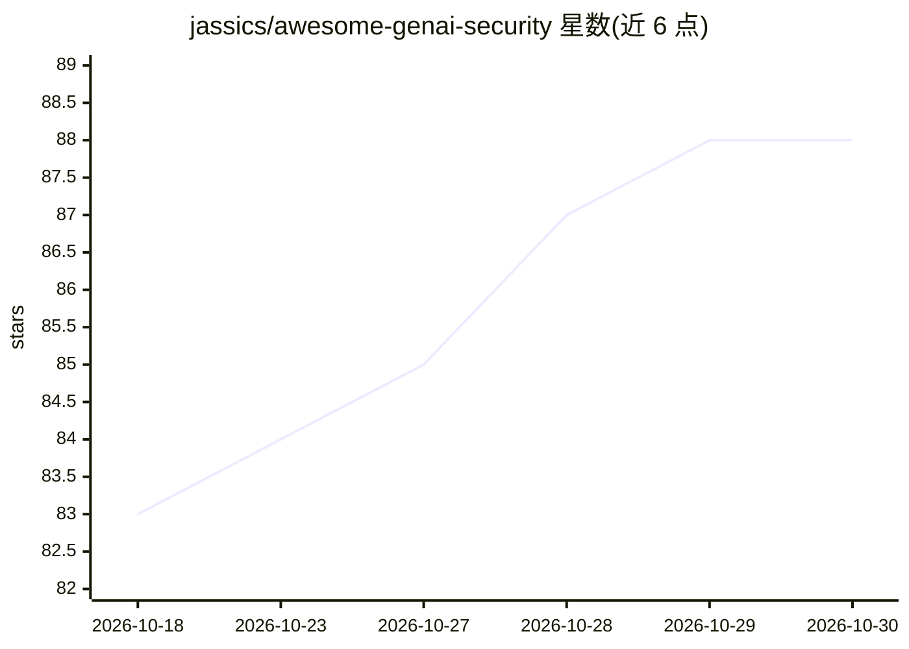

# jassics/awesome-genai-security

⭐ 88 · GPL-3.0 · 推送 2026-10-26 · [GitHub](https://github.com/jassics/awesome-genai-security) · 个人维护

**GenAI/Agentic AI 安全领域链接与资源的策展清单**

面向从业者的策展清单：汇总与 GenAI、LLM、RAG、MCP、Agent 及 Agentic AI 安全相关的书籍、视频、课程、认证、红队资料、教程博客与真实攻击事件记录。内容按 LLM/RAG/MCP/Agents 等子域拆分为独立分类页，主页保留跨领域材料（书籍、课程、认证、法规与事件时间线）。已合并 awesome-agentic-ai-security 清单，声明定位为实践导向而非学术跟踪。

## 筛选速览

| 维度 | 判定 | 备注 |
|---|---|---|
| AI 角色 | `ai-knowledge` | 知识聚合/清单类 |
| 许可风险 | `viral` | GPL-3.0 |
| 部署形态 | `library` | 以包/库形式分发 |
| 模型依赖 | — | README 未给出锁定关系 |
| 硬件要求 | — | 无带数字的原话,不猜 |
| 安装摩擦 | `low` | 无编译、无系统依赖或容器化 |
| 成熟度 | — | 结构信号不足 |

## 能力要点

- 覆盖 LLM/RAG/MCP/Agents/A2A/运行时/可观测性等 7 个安全子域分类页
- 收录书籍、课程、认证、红队指南与学习路线等跨领域资源
- 按时间倒序记录 GenAI 安全真实攻击与泄露事件（15 起以上）
- 已合并 awesome-agentic-ai-security 清单

## 适用场景

- 系统学习 LLM 与 Agentic AI 安全知识并规划职业路径
- 查找各安全子域的工具、标准与实践资源
- 跟踪 GenAI 相关真实攻击事件与漏洞案例

## 场景标签

`精选清单` `网络安全` · 领域:学习与行业

## 证据(README 行号)

> L8: A curated list of links, references, books, videos, tutorials (Free or Paid), Exploit, CTFs, Hacking Practices, etc.
> L14: ## GenAI Security Categories

## 星数曲线

2026-10-18 83 → 2026-10-30 88（+5）

---
*卡片 v1 · prompt 1.4 · 生成 2026-10-24 · 置信度 mid · 依据 README sha `098324d5a377` · [字段定义](../../DATASET.md)*
