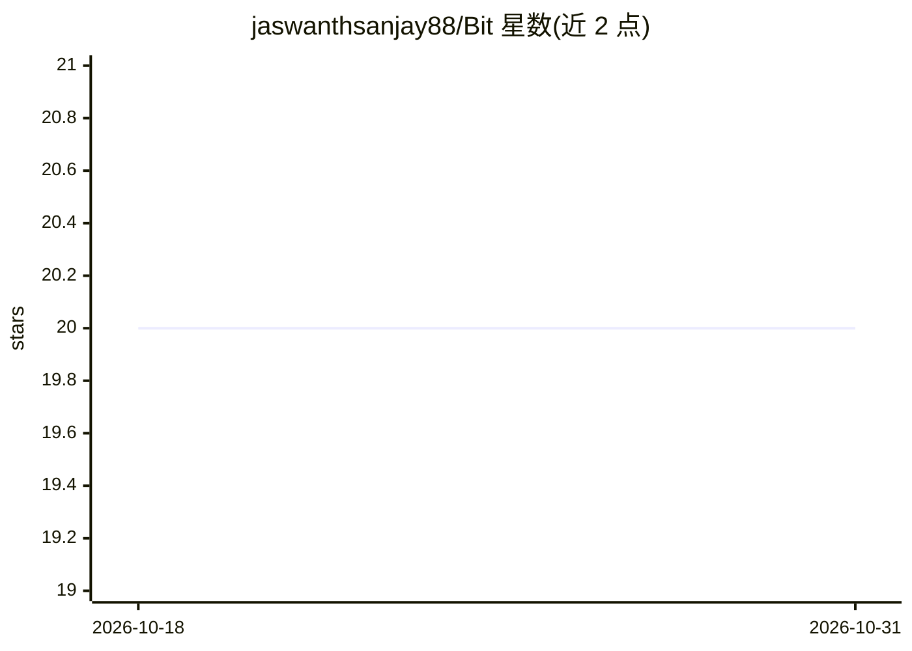

# jaswanthsanjay88/Bit

⭐ 20 · C++ · Apache-2.0 · 推送 2026-10-19 · [GitHub](https://github.com/jaswanthsanjay88/Bit) · [官网](https://bit.jaswanthsanjay.me) · 个人维护

**Android 端本地运行 LLM/视觉/图像生成的隐私优先 AI 助手**

面向 Android 用户的端侧 AI 助手应用：通过自研 llama.kt SDK（llama.cpp 的 JNI 封装）在本地运行量化 GGUF 模型，提供文本生成、视觉理解（CLIP 投影）、GBNF 约束的结构化工具调用、Stable Diffusion 1.5 图像生成、本地文档 RAG（向量+BM25）、长期记忆、TTS 与加密备份。支持 Llama/Mistral/Gemma/Phi/Qwen 系列模型，ARM64/x86_64 加速，并可接入 OpenAI 兼容云端 API。要求 Android 10+、6GB 内存起，提供预构建 APK 与 F-Droid 元数据。

## 筛选速览

| 维度 | 判定 | 备注 |
|---|---|---|
| AI 角色 | `ai-native` | 本体是模型或模型工具 |
| 许可风险 | `permissive` | Apache-2.0 |
| 部署形态 | `desktop` | 安装包/桌面程序 |
| 模型依赖 | local-ok | 支持本地模型 |
| 硬件要求 | — | 无带数字的原话,不猜 |
| 安装摩擦 | `low` | 无编译、无系统依赖或容器化 |
| 成熟度 | — | 结构信号不足 |

## 能力要点

- 本地 GGUF 推理（llama.kt/llama.cpp JNI），无云端依赖
- GBNF 文法约束的两阶段工具调用，保证 JSON 输出有效
- 端侧 Stable Diffusion 1.5 文生图/修复/放大
- 本地文档 RAG（向量+BM25 混合检索）与长期情景记忆

## 适用场景

- 在手机上离线运行大语言模型对话与视觉问答
- 对本地 PDF/Word/EPUB 文档做隐私优先的检索问答
- 内存受限设备上通过 mmap 加载超出 RAM 的模型

## 场景标签

`AI 助手` `文档问答` `图像生成` `语音合成` · 领域:对话与助手

## 证据(README 行号)

> L13: BIT is a privacy-first AI assistant that runs large language models, vision models, image generation, document retr
> L27: All inference is performed locally using quantized GGUF model files. The application supports models from the Llama

## 星数曲线

2026-10-18 20 → 2026-10-31 20（+0）

---
*卡片 v1 · prompt 1.4 · 生成 2026-10-28 · 置信度 high · 依据 README sha `54a0bcff704d` · [字段定义](../../DATASET.md)*
